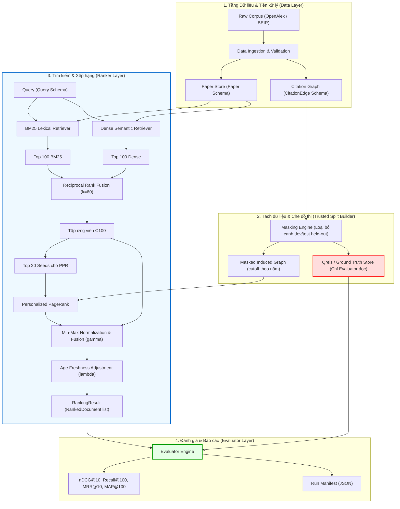

# Kiến trúc hệ thống — ScholarGraph VN

Phiên bản: 1.0.0  
Task mốc: SG-006 (Milestone M1)  
Tài liệu liên quan: [Kế hoạch tổng thể](MASTER_PLAN.md), [Giao thức nghiên cứu v1](RESEARCH_PROTOCOL.md), [Hợp đồng JSON v1](../configs/protocol_v1.json).

---

## 1. Tổng quan hệ thống

ScholarGraph VN là hệ thống tìm kiếm và gợi ý bài báo khoa học kết hợp cả **nội dung văn bản (lexical BM25, dense semantic embeddings)** và **cấu trúc đồ thị trích dẫn (Personalized PageRank, Age adjustment)**, hỗ trợ đánh giá truy vấn đa ngữ (Anh và Việt).

Kiến trúc hệ thống được thiết kế theo nguyên tắc:
1. **Ranh giới dữ liệu độc lập và chống rò rỉ (Data Leakage Protection)**: Phân tách rõ ràng giữa module sinh kết quả tìm kiếm (Ranker) và module đánh giá chất lượng (Evaluator).
2. **Khả năng tái lập cao (Reproducibility)**: Mọi thực nghiệm (run) đều được gắn manifest định danh, băm toàn vẹn (data hash, config hash, split hash).
3. **Data Contracts chặt chẽ**: Dữ liệu trao đổi giữa các thành phần tuân theo Pydantic v2 schemas với validation nghiêm ngặt.

---

## 2. Sơ đồ kiến trúc luồng dữ liệu (Data Flow)



---

## 3. Ranh giới dữ liệu và nguyên tắc chống rò rỉ (Data Leakage Boundaries)

Theo quy định tại Mục 2 của [RESEARCH_PROTOCOL.md](RESEARCH_PROTOCOL.md):

| Thành phần | Dữ liệu được phép đọc | Dữ liệu tuyệt đối CẤM |
|---|---|---|
| **Ranker / Retriever** | Corpus văn bản (`title`, `abstract`), `Query`, masked graph đã che, danh sách ứng viên hợp lệ. | **Qrels**, nhãn liên quan (`relevance labels`), các cạnh held-out trong dev/test, feature suy ra từ nhãn. |
| **Split Builder / Auditor** | Đọc corpus, references, metadata năm để tạo masked graph và tách tập held-out. | Không xuất danh sách qrels hoặc gợi ý đáp án sang Ranker. |
| **Evaluator** | Đầu ra xếp hạng của Ranker (`RankingResult`), tập nhãn chân lý (`Qrel`), danh sách query ID chính thức. | Không chỉnh sửa ranking của Ranker; không chia sẻ nhãn cho ranker trước hoặc trong khi chạy. |

### Cơ chế bảo vệ trong mã nguồn:
- Interface `BaseRanker` trong `src/scholargraph/data/interfaces.py` áp dụng **Template Method Pattern**:
  - Phương thức công khai `rank()` đóng vai trò cổng kiểm soát duy nhất, duyệt qua danh sách khóa bị cấm `FORBIDDEN_RELEVANCE_KEYS` (`qrels`, `labels`, `ground_truth`, `heldout_edges`, `test_labels`, `human_labels`).
  - Nếu phát hiện bất kỳ tham số nào chứa dữ liệu nhãn hoặc cạnh held-out, ngoại lệ `DataLeakageError` sẽ lập tức được kích hoạt.
  - Subclass chỉ cài đặt hook nội bộ `_rank()` và không thể vô hiệu hóa cơ chế bảo vệ kể cả khi quên gọi `super()`.

---

## 4. Phân biệt các định danh (Identifiers)

Trong nghiên cứu truy hồi thông tin và khai phá web, việc nhầm lẫn giữa các loại định danh dẫn đến sai lệch dữ liệu nghiêm trọng:

1. **Paper ID (Canonical Document ID)**:
   - Là khóa chính duy nhất của một bài báo trong snapshot dữ liệu (ví dụ: `openalex:W2741809807` hoặc `scifact:42`).
   - Luôn tồn tại với mọi tài liệu trong hệ thống.
2. **DOI (Digital Object Identifier)**:
   - Là định danh xuất bản học thuật quốc tế (ví dụ: `10.1145/3397271.3401075`).
   - **Không phải bài báo nào cũng có DOI** (nhiều bài báo chỉ có ID nội bộ của kho lưu trữ).
   - Được định dạng chuẩn qua hàm kiểm tra `validate_doi()`. Tuyệt đối không dùng DOI thay thế Paper ID khi liên kết đồ thị hoặc đánh giá.
3. **Query ID**:
   - Là mã định danh duy nhất của một nhu cầu tìm kiếm (ví dụ: `scifact_dev:q101`, `vn:q01`).
   - Không được trùng với Paper ID.
4. **Qrel Label (Relevance Grade)**:
   - Là mức độ phù hợp của tài liệu đối với truy vấn (thang điểm: 0 - Không liên quan, 1 - Liên quan một phần, 2 - Trực tiếp giải quyết nhu cầu).
   - Chỉ thuộc về bảng đánh giá `Qrel`, không gắn cố định vào Paper.

---

## 5. Quy tắc Namespace ID và Chính sách giá trị thiếu (Null Policy)

### 5.1 Namespace ID
Để tích hợp nhiều nguồn dữ liệu (OpenAlex, BEIR SciFact, BEIR SCIDOCS, Vietnamese custom queries) mà không xung đột khóa chính:
- Định dạng chuẩn: `<namespace>:<raw_id>` (ví dụ: `openalex:W12345`, `beir_scifact:42`, `synth:paper_001`).
- Các hàm tiện ích: `make_canonical_id(namespace, raw_id)` và `parse_namespace_id(canonical_id)`.

### 5.2 Chính sách giá trị thiếu (Null Policy)
| Trường | Trạng thái thiếu | Xử lý hệ thống | Ràng buộc học thuật |
|---|---|---|---|
| `abstract` | `None` / rỗng | Tự động chuyển thành `""` (chuỗi rỗng). | Không làm crash indexer; ghi nhận tỷ lệ coverage trong audit. |
| `year` | `None` | Giữ nguyên `None`. | **Tuyệt đối không điền giá trị trung bình/trung vị (no median imputation)**. Trong Tuyến B (OpenAlex citation holdout), bài báo thiếu năm bị loại khỏi tập ứng viên hợp lệ $U(u)$ theo protocol §4/§5.4. |
| `doi` | `None` / rỗng | Giữ nguyên `None`. | Không ảnh hưởng đến index văn bản hay đồ thị trích dẫn. |
| `score` | `NaN` / `Inf` | **Bị từ chối (báo lỗi validation)**. | Điểm số xếp hạng bắt buộc phải là số thực hữu hạn (`finite float`). |
| `references` | rỗng | Danh sách rỗng `[]`. | Nút đóng vai trò dangling node trong Personalized PageRank (được xử lý phân phối lại xác suất theo protocol §5.3). |

---

## 6. Hợp đồng Xếp hạng và Run Manifest (Ranking & Run Contracts)

### 6.1 Quy tắc thứ tự chuẩn hóa (Canonical Tie-breaking)
Khi hai tài liệu có điểm số bằng nhau trong danh sách xếp hạng:
1. Ưu tiên điểm số giảm dần (`score` descending).
2. Khi điểm bằng nhau, phá hòa bằng **mã tài liệu tăng dần theo mã Unicode code points** (`doc_id` ascending).
3. Đảm bảo tính tất định 100% giữa các lần chạy khác nhau trên các môi trường tính toán khác nhau.

### 6.2 Định dạng kết quả (TREC Run Format)
Mỗi dòng kết quả xuất ra theo chuẩn quốc tế TREC:
```text
<query_id> Q0 <doc_id> <rank> <score> <run_id>
```
Theo quy định tại Protocol §6.1 và `protocol_v1.json`:
- Công cụ `trec_eval` tự động sắp xếp lại theo score giảm dần và khi bằng điểm sẽ phá hòa bằng `doc_id` giảm dần (ngược với quy ước chuẩn hóa của hệ thống).
- Do đó, phương thức `to_trec_lines()` mặc định xuất **điểm giảm dần nghiêm ngặt**: `score = N - rank + 1` (với $N$ là tổng số ứng viên). Cách này triệt tiêu hoàn toàn hiện tượng ties trong file TREC, bảo đảm `trec_eval` tôn trọng chính xác 100% thứ tự của `RankingResult`.
- Điểm số nguyên bản của từng phương pháp (`raw scores`) được lưu trữ độc lập trong artifact kết quả để phục vụ phân tích chi tiết.

### 6.3 Run Manifest
Mỗi lượt chạy thực nghiệm sinh ra một bản ghi `RunManifest` (`artifacts/runs/RUN-*.json`) chứa:
- `run_id`: Tên mã chạy chuẩn hóa (`RUN-YYYYMMDD-HHMMSS-method-dataset-split`).
- `config_hash`: Băm SHA-256 của file cấu hình thực nghiệm.
- `data_hash` & `split_hash`: Băm toàn vẹn dữ liệu và phân chia tập train/dev/test.
- `parameters`: Toàn bộ siêu tham số của mô hình (ví dụ: $k_1, b, \gamma, \lambda$).
- `hardware_info`: Thông tin thiết bị phần cứng (CPU, GPU, RAM, phiên bản OS).
- `metrics`: Các chỉ số đo lường do Evaluator ghi nhận.
- `synthetic`: Cờ boolean bắt buộc (`synthetic=True` cho các run thử nghiệm từ fixture dữ liệu nhân tạo; cấm đưa vào các bảng báo cáo học thuật).
