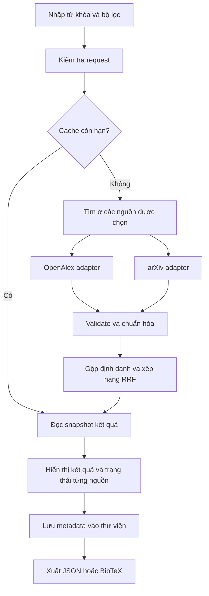

# Kế hoạch mở rộng ScholarGraph: tìm kiếm bài báo từ nguồn công khai

- Ngày lập: 2026-09-30, UTC+07:00.
- Nhánh Git: `codex/public-paper-search`.
- Điểm xuất phát: `83358a9ec4add841293bc09c419b17c8dbb3bc0f` trên `master`.
- Phạm vi được giao trong phiên này: tạo nhánh và kế hoạch chi tiết.
- Trạng thái: kế hoạch đã soạn; các chức năng dưới đây chưa triển khai, chưa đo.
- Mã `EXT-01`..`EXT-10` là work package trong kế hoạch này, chưa phải task được đăng ký trên board `SG-NNN`.

## 1. Mục tiêu và hiện trạng đã kiểm tra

Người dùng tìm bài theo từ khóa, xem thông tin nguồn, mở trang bài/PDF công khai và lưu metadata vào thư viện cá nhân. Luồng có thể tìm dữ liệu mới bên ngoài corpus hiện có.

Hiện trạng mã nguồn:

- `src/scholargraph/api/app.py` có `/search`, `/paper/{doc_id}`, `/recommend/{doc_id}` và giao diện snapshot.
- `src/scholargraph/api/service.py` phục vụ corpus SciFact cố định với BM25/dense/hybrid.
- `src/scholargraph/ingest/openalex.py` đã có tải OpenAlex, cache trang, resume, kiểm tra manifest và xử lý lỗi mạng. Cấu hình pilot theo topic khác hợp đồng tìm theo từ khóa; cần adapter riêng.
- Giao diện `ui/templates/search.html` đang hướng tới truy vấn tiếng Anh trên snapshot.
- SG-030/SG-033 đang chờ đầu vào con người. Phần mở rộng có đường triển khai riêng và không phụ thuộc nhãn VN để xây chức năng.

## 2. Phạm vi theo giai đoạn

### Giai đoạn A — MVP tìm trực tuyến và thư viện

1. Trang riêng **Tìm trên nguồn công khai**, có liên kết từ giao diện hiện tại.
2. Hai nguồn đầu tiên: OpenAlex và arXiv.
3. Nhập từ khóa, chọn nguồn, khoảng năm, số kết quả; xem tiêu đề, tác giả, tóm tắt nếu có, năm, định danh và liên kết nguồn.
4. Gộp bài trùng có định danh tin cậy; hiển thị các nguồn đã tìm thấy cùng một bài.
5. Xếp hạng bằng RRF trên thứ tự kết quả của nguồn; giải thích đây là thứ tự tìm kiếm.
6. Lưu metadata, xem thư viện, xuất JSON/BibTeX với provenance.
7. Cache truy vấn có TTL; làm mới do người dùng chủ động.
8. Trạng thái tải, không có kết quả, dữ liệu thiếu, lỗi từng nguồn và giới hạn lượt truy cập rõ ràng.

Metadata công khai và quyền đọc toàn văn là hai thuộc tính độc lập. Link trang bài không tự chứng minh bài có bản PDF được phép đọc. MVP hiển thị link do nguồn cung cấp và trạng thái quyền truy cập khi có bằng chứng.

Truy vấn MVP giữ nguyên văn bản người dùng nhập. UI nói rõ nhiều nguồn chủ yếu lập chỉ mục tiếng Anh. Dịch Việt–Anh là bước sau, cần lưu cả truy vấn gốc và truy vấn đã dịch, có thao tác bật rõ ràng và đánh giá riêng.

### Giai đoạn B — bổ sung metadata và quét website

- `EXT-09`: Crossref lookup theo DOI, tùy chọn tìm metadata sau pilot; giữ metadata ban đầu và ghi provenance cho phần bổ sung.
- `EXT-10`: crawler HTML cho **một website thí điểm được chọn cụ thể**: tạp chí, kho trường đại học hoặc repository công khai. Sau pilot mới thêm website thứ hai.
- Crawler đi từ trang danh sách/kết quả tới trang chi tiết, ưu tiên `citation_*`, JSON-LD hoặc metadata Dublin Core. Selector theo từng site, có version.
- Lưu raw HTML, URL, thời gian lấy, hash, parser version; normalize về cùng schema với API.
- Trước pilot phải xác minh điều kiện truy cập, robots.txt và phạm vi URL của chính site đó. Đọc được một trang bằng trình duyệt chưa đủ để quyết định quét hàng loạt.

Full-text indexing, tải PDF hàng loạt, OCR, graph trực tuyến, dense reranking và lịch quét tự động được đưa ra sau khi MVP có số đo và nhu cầu cụ thể. MVP chạy theo request/CLI chủ động.

## 3. Nguồn và điều kiện tích hợp

| Nguồn | Đầu vào / đầu ra dự kiến | Điểm cần xác minh khi triển khai |
|---|---|---|
| OpenAlex | Từ khóa; metadata works, DOI, tác giả, địa điểm truy cập và references nếu trả về | Auth/quota thực tế, query syntax, trường thiếu và phân trang |
| arXiv | Search query; feed Atom, arXiv ID/version, abstract, authors, link trang/PDF | Terms API, tốc độ, query escaping, lỗi Atom và version |
| Crossref (B) | DOI lookup; metadata bổ sung | Metadata có thể thiếu abstract; đọc rate/concurrency headers |
| Website HTML (B) | URL danh sách/chi tiết trong allowlist | Quy tắc truy cập, selector, robots, giới hạn độ sâu và số trang |

Tài liệu chính thức kiểm tra ngày 2026-09-30:

- [OpenAlex API](https://help.openalex.org/api/) và [Authentication](https://help.openalex.org/api/authentication/): truy vấn cơ bản có thể dùng không key; key miễn phí tăng budget. Gửi key bằng Authorization header. Quota phải được đọc từ phản hồi và kiểm tra lại trước pilot.
- [arXiv API User Manual](https://info.arxiv.org/help/api/user-manual.html): hỗ trợ truy vấn, kết quả Atom, định danh/version và liên kết. Trang Terms liên kết trong manual chưa truy xuất được trong phiên lập kế hoạch; đây là đầu vào cần xác minh tại EXT-01.
- [Crossref REST API](https://www.crossref.org/documentation/retrieve-metadata/rest-api/) và [Access](https://www.crossref.org/documentation/retrieve-metadata/rest-api/access-and-authentication/): metadata qua API công khai; có hướng dẫn mailto/User-Agent, cache và rate/concurrency headers.

Các URL trên là tài liệu tham chiếu; phiên này chưa gọi search API để đo tính sẵn sàng. Không tự tạo tài khoản, mua quota hoặc coi mọi endpoint luôn miễn phí. Nếu budget không đủ thì dừng và báo rõ.

## 4. Luồng sản phẩm và kiến trúc tối thiểu

Tận dụng FastAPI, httpx và UI HTML/JS đang có. Dùng `sqlite3` để lưu cache/thư viện; không cần thêm queue hoặc server database cho MVP. Một service và hai adapter cụ thể là đủ.

Vị trí dự kiến (chưa tồn tại như kết quả triển khai):

| Thành phần | Đường dẫn dự kiến |
|---|---|
| Schema, adapter và orchestration | `src/scholargraph/public_search/` |
| Router API | `src/scholargraph/api/public_routes.py` |
| UI | `ui/templates/public_search.html`, `ui/static/public_search.js` |
| Cấu hình không chứa secret | `configs/public_search.json` |
| CLI tìm và kiểm tra nguồn | `scripts/search_public.py` |
| Raw payload theo request ID | `data/public_search/raw/` |
| SQLite cache/thư viện | `data/public_search/library.sqlite3` |
| Manifest truy vấn | `data/public_search/manifests/` |
| Tests | `tests/unit/test_public_*.py`, `tests/integration/test_public_search.py` |
| Báo cáo đo và test | `artifacts/reports/public_search/` |

Router online khởi tạo độc lập với SearchService/index SciFact. Trang online vẫn mở được khi corpus offline chưa được cài; lỗi offline được giữ tại route offline. Không gọi model embedding hoặc đọc nhãn để khởi tạo online.

Secret chỉ trong biến môi trường; URL/log/cache không chứa key. Tái sử dụng logic HTTP của ingest chỉ khi tách được một cách rõ ràng; không sửa hành vi tải snapshot nghiên cứu để đáp ứng search online.

## 5. Hợp đồng dữ liệu, gộp trùng và xếp hạng

### Bản ghi bài báo

- Bắt buộc: `source`, `source_id`, `title` không rỗng, `landing_url`, `retrieved_at`, `raw_sha256` và parser version.
- Tùy chọn với `null` tường minh: `abstract`, `publication_year`, `doi`, `venue`, `pdf_url`, `license`, `open_access_status`, `citation_count`.
- `authors` có trạng thái availability; không coi danh sách rỗng tự động là đã biết bài không có tác giả.
- Có `missing_fields`, `source_records`, provenance theo field và các xung đột chưa hòa giải.
- Title-only hợp lệ nếu còn ID/nguồn/link hợp lệ; text-only thiếu title/ID bắt buộc phải FAIL. Không bịa abstract, năm hay DOI.
- Năm phải đúng kiểu và trong khoảng được khai báo trong schema; citation count nếu có phải là số nguyên không âm. Các score nội bộ phải hữu hạn.
- URL phải là HTTP(S), không có credentials; giá trị nguy hiểm không được render thành link.

### Gộp trùng

1. Chuẩn hóa DOI: bỏ DOI resolver/prefix, trim và casefold; kiểm tra format, giữ giá trị raw.
2. arXiv: giữ version trong source record, dùng ID nền cho nhóm version cùng bài.
3. Gộp giữa nguồn bằng DOI hoặc arXiv ID **được nguồn cung cấp tường minh**. Không suy ra DOI từ title gần giống.
4. Title giống chỉ là cờ nghi trùng; giữ hai bản ghi nếu không có bằng chứng định danh.
5. Một arXiv ID gắn nhiều DOI khác nhau được giữ như xung đột/quan hệ phiên bản; không bắc cầu tùy tiện gộp các DOI.
6. Trường mâu thuẫn giữ từng giá trị và nguồn. Chọn giá trị hiển thị bằng quy tắc xác định, không ghi đè provenance.

### Xếp hạng và độ phủ

- Lấy tối đa 50 ứng viên/nguồn/request trong MVP; giới hạn này là budget đề xuất, không phải số đã đo.
- Apply bộ lọc trước fusion; trường năm thiếu không đạt bộ lọc năm và được đếm tường minh.
- Với nguồn có lọc server-side, truyền bộ lọc và kiểm tra lại payload. Nếu phải post-filter trên pool hữu hạn, UI ghi rõ phạm vi lọc và truncation.
- RRF: tổng `1/(60 + rank)` trên các nguồn, rank bắt đầu từ 1. Một nguồn đóng góp tối đa một lần cho một bài; tie theo canonical ID.
- Phân trang trên snapshot kết quả của request, tránh kết quả thay đổi giữa các trang. Mỗi request tạo manifest/snapshot ID.
- Tổng kết quả trả về là số bài trong pool đã tìm; không gọi là tổng số bài trên toàn web. Count toàn nguồn nếu có phải ghi riêng theo từng nguồn.
- Citation count có thể hiển thị như metadata; không gọi đó là độ đúng hoặc độ liên quan.

## 6. API, lưu trữ và xử lý lỗi

API dự kiến:

| Route | Chức năng |
|---|---|
| `GET /public` | Trang tìm trực tuyến, không khởi tạo index offline |
| `GET /public/search` | Query, nguồn, khoảng năm, top_k; trả snapshot ID, hits và source statuses |
| `GET /public/results/{snapshot_id}` | Đọc trang kết quả đã chốt |
| `POST /public/library` | Lưu một bài có ID thuộc snapshot đã kiểm tra |
| `GET /public/library` | Danh sách đã lưu |
| `GET /public/library/export` | Xuất JSON/BibTeX, escape dữ liệu đúng định dạng |

Không nhận URL tùy ý để backend tải thay người dùng. Crawler B nhận site ID trong config allowlist. Redirect cũng kiểm tra host/IP mới; từ chối localhost, private IP và scheme ngoài HTTP(S). XML parser phải không resolve external entities; UI dùng text/escaped HTML.

Cache key gồm query, filters, nguồn, adapter/config version. TTL đề xuất 24 giờ; có fetched_at/expires_at. Cache quá hạn chỉ mở qua lựa chọn xem bản đã lưu và ghi `stale=true`; lỗi mạng không tự thay bằng cache cũ rồi báo thành công.

Cache ghi transaction; raw payload/manifest ghi atomically. Hash sai hoặc schema version không đọc được phải báo FAIL. Thư viện lưu metadata để xem offline; không hứa đọc PDF offline khi chưa tải file.

### Chính sách FAIL rõ ràng

- Source status phân biệt: `success`, `empty`, `failed`, `not_requested`. Response overall: `success` chỉ khi tất cả nguồn được chọn thành công; `partial_failure`/`failed` kèm error cụ thể khi có nguồn lỗi.
- HTTP upstream timeout trả 504; lỗi upstream/schema trả 502; quota trả 503 kèm retry info; request nội bộ sai trả 422; lỗi storage trả 500. Khi nhiều lỗi, ưu tiên theo quy tắc ghi trong contract.
- Nếu một nguồn thành công và một nguồn lỗi, payload có thể chứa kết quả đã lấy để người dùng xem, nhưng HTTP vẫn non-2xx và UI hiển thị rõ chưa tìm đủ nguồn. CLI tương ứng bắt buộc exit **1**.
- Response hợp lệ với 0 kết quả là `empty`, không phải giả lập lỗi mạng thành rỗng.
- Bản ghi thiếu trường bắt buộc làm request nguồn đó FAIL, ghi offending record ID/index. Có thể giữ raw evidence, không im lặng bỏ record rồi báo success.
- Retry chỉ lỗi tạm thời, bounded attempts/deadline; tôn trọng Retry-After và quota reset. Không thu ngắn thời gian chờ nguồn yêu cầu để đạt target latency; hết deadline thì FAIL có retry info.
- Auth sai/mất key khi mode yêu cầu key phải FAIL; không chuyển ngầm sang anonymous.

Giới hạn vận hành **đề xuất để pilot**, không phải giới hạn chính thức: một request đồng thời/nguồn, khoảng nghỉ arXiv ít nhất 3 giây và OpenAlex ít nhất 1 giây; tối đa 2 retries; total deadline 30 giây; raw body tối đa 10 MB. EXT-01 phải xác minh điều kiện từng nguồn và cập nhật config trước chạy thật.

## 7. Các work package và nghiệm thu

Ước lượng giờ triển khai/kiểm thử với agent hỗ trợ dưới đây là dự trù, không phải cam kết thời gian chạy hay số giờ đã làm. Thực hiện tuần tự với một worker mặc định.

| Mã | Phụ thuộc | Việc và đầu ra | Tiêu chí nghiệm thu | Giờ dự trù |
|---|---|---|---|---|
| EXT-01 | Kế hoạch này | Pilot khả dụng nguồn; config, contract/schema, source audit | Xác minh search API/terms/quota, có raw responses thật, lỗi auth/quota rõ; pin điều kiện trước code chính | 2–3 |
| EXT-02 | EXT-01 | Adapter OpenAlex, tests JSON | Search/filter/paging đúng, thiếu abstract được ghi nhận, missing ID/title và lỗi network FAIL exit 1 | 4–6 |
| EXT-03 | EXT-01 | Adapter arXiv, tests Atom | Parse ID/version/link, query escaping, timeout/429/Atom lỗi và XML nguy hiểm được kiểm tra | 5–7 |
| EXT-04 | EXT-02,03 | Dedup, RRF, bounded pool và manifest | DOI/version/conflict đúng, deterministic rank/ties, counts khớp, không merge bằng title fuzzy | 4–6 |
| EXT-05 | EXT-04 | API router và UI online | Search thật end-to-end; loading/empty/partial failure; links an toàn; online hoạt động thiếu index offline | 5–7 |
| EXT-06 | EXT-04,05 | SQLite cache/thư viện, export | Save idempotent, cache key/version/TTL, hash corruption FAIL, JSON/BibTeX truy ngược nguồn | 3–5 |
| EXT-07 | EXT-02..06 | Test phá hủy, regression, đo pilot | Toàn bộ ma trận mục 8 pass, số đo có raw evidence, freeze không drift | 5–7 |
| EXT-08 | EXT-07 | Hướng dẫn dùng/demo, packet review và handoff | Người dùng kiểm tra demo; log/commands rõ; review đúng quy trình; đủ evidence trước tích hợp | 4–6 |
| EXT-09 (B) | EXT-08 | Crossref enrichment | DOI lookup, provenance/xung đột/rate limit/CLI FAIL được kiểm tra | 4–6 |
| EXT-10 (B) | EXT-08 + site audit | Một crawler HTML có allowlist/config/parser | Crawl có budget/resume, raw HTML/hash; robots/redirect/parser change FAIL; end-to-end site thật | 6–10 |

Tổng MVP A: **32–47 giờ công dự trù**. Giai đoạn B: thêm **10–16 giờ**. Dự kiến chia MVP thành 4–6 phiên triển khai/kiểm thử tùy độ dài phiên và khả dụng API; không suy ra ngày hoàn thành từ số phiên.

Mốc review:

- M1 sau EXT-01: nguồn hoạt động, schema và failure contract chốt.
- M2 sau EXT-04: tìm hai nguồn, dedup và rank có tests.
- M3 sau EXT-06: demo UI, lưu và export chạy thật.
- M4 sau EXT-08: đủ test phá hủy, số đo và hướng dẫn để review/tích hợp.

Điểm dừng có thể bàn giao: nếu arXiv chưa truy cập được hoặc điều kiện chưa xác minh, báo rõ nguồn chưa sẵn sàng; không tuyên bố hoàn thành MVP hai nguồn. Có thể đề xuất phạm vi một nguồn bằng decision có bằng chứng.

## 8. Kiểm thử bắt buộc và phép đo

Tests dùng thư mục tạm, dữ liệu synthetic có đánh dấu, HTTP mocked có lỗi chủ đích. Smoke live chạy riêng, lưu raw response; không dùng fake responses để tuyên bố nguồn hoạt động thật.

| Nhóm | Ca thử tối thiểu | Kết quả yêu cầu |
|---|---|---|
| Tài nguyên | Config thiếu, mode cần key thiếu key, raw payload/manifest thiếu, SQLite path không ghi được | FAIL cụ thể; CLI subprocess exit 1 |
| Dữ liệu | Title-only, abstract-only, ID thiếu, JSON/Atom hỏng, DOI sai, year sai kiểu, citation âm, score NaN/Inf | Title-only hợp lệ theo schema; trường bắt buộc/số sai FAIL; optional null không bịa |
| Trùng/xung đột | DOI case/prefix, arXiv nhiều version, title giống khác DOI, DOI mâu thuẫn, cùng bài nhiều hit cùng nguồn | Groups/provenance đúng; một nguồn đóng góp rank một lần |
| Mạng | 401/403/429/5xx, timeout, Retry-After vượt deadline, một nguồn lỗi, tất cả nguồn lỗi | Không biến thành empty/success; HTTP và CLI đúng contract |
| Cache/lưu | Quá TTL, đổi filter/adapter, hash sai, ghi bị ngắt, lưu hai lần | Không cache hit nhầm; stale tường minh; atomicity/idempotency |
| UI/API | Request rỗng/quá dài, year đảo, nguồn không hợp lệ, HTML/script trong title, URL javascript, invalid save ID | Validation rõ, không XSS/link nguy hiểm; không lưu nguồn giả |
| Crawl B | robots từ chối/không xác minh được, redirect ngoài allowlist/private IP, HTML đổi selector, body quá lớn | Dừng và lỗi rõ; không bypass selector/robots bằng dữ liệu giả |
| Leakage | qrels/nhãn/held-out edges sentinel; thiếu hoặc dị dạng split ở audit snapshot | Online không đọc nhãn; artifact không ghi vào core; audit split lỗi exit 1 |
| Hồi quy | Route offline, graph, export cũ; hash freeze trước/sau | Contract cũ pass, hash bất biến; môi trường offline vẫn dùng được |

Ngăn leakage kiểm bằng instrumentation đường đọc file và kiểm tra mọi đầu vào/đầu ra, không chỉ tìm keyword trong code. Split không thuộc đầu vào search online; audit bảo vệ bộ nghiên cứu kiểm tra split/manifest theo yêu cầu dự án và phải FAIL khi thiếu, không tạo split giả.

Pilot đo trên tập query mới do người dùng/hai thành viên xác nhận, độc lập query dev/test đã đóng băng. Dự kiến 10 query tiếng Anh thuộc nhiều chủ đề, 3 lượt/query cho cache miss/hit khi quota cho phép; lưu request IDs, configs, times và payload hashes. Số lượt thực tế phải báo đúng, query không thành công cũng được giữ.

Chỉ số vận hành: latency từng nguồn và end-to-end; median/P95 với cỡ mẫu và cách tính; cache hit rate; failed/empty/success counts; record counts, dedup groups/conflicts và coverage metadata. Mục tiêu pilot đề xuất cache hit P95 dưới 500 ms và search thành công P95 dưới 15 giây trong budget; chưa đo và không bảo đảm trước pilot.

Counts phải đối chiếu: raw_records = valid_records + invalid_records; nếu invalid_records > 0 thì source FAIL. Với nguồn hợp lệ: valid_records = eligible_records + filtered_records; eligible_records = unique_groups + duplicate_excess. Không cộng tổng global của các nguồn thành tổng bài duy nhất. Partial run không được ghi status hoàn thành.

Chất lượng relevance nếu chấm thủ công thì lưu judgments/protocol riêng của extension trước khi dùng metric; không báo nDCG/MRR khi chưa có nhãn. Không nhập kết quả online vào bảng Track A/B/C hoặc dùng để đổi config freeze.

## 9. Quản lý nhánh, review và bàn giao

- Các commit triển khai nhỏ theo EXT-01..08; chỉ sửa bên trong `scholargraph/`.
- Raw/cache/SQLite/key không commit; cập nhật ignore đúng scope khi triển khai. Fixture sạch và source audit có thể commit với nhãn provenance rõ.
- Trước mỗi phiên kiểm tra Git, file đang thay đổi và tiến trình thực tế. Không coi timestamp cũ là quyền chiếm task SG-030/033.
- Khi bắt đầu implementation, coordinator đăng ký SG IDs/task cards/routing phù hợp và chuyển các work package được giao sang board; chưa claim cả backlog trong phiên lập kế hoạch.
- Do registry vẫn có coordinator C và assignments SG-030/033, phiên này ghi kế hoạch/log riêng, không sửa trạng thái các task hiện có. Không tạo chat/agent/automation từ bảng phân việc.
- Review độc lập cần phiên/context có thật nếu task được đặt gate đó; self-check phải ghi đúng là self-check. Không bịa reviewer hoặc human approval.
- Trước tích hợp: M4 đạt, kiểm tra regression và freeze hash, người dùng xem demo mới, ghi quyết định phạm vi tích hợp. Merge vào `master` là bước sau kế hoạch này.

## 10. Bước kế tiếp có thể thực hiện

Sau khi được giao triển khai: nhận EXT-01, kiểm tra search endpoints thật với request budget nhỏ, xác minh arXiv Terms và quota, lưu source audit/config/schema. Nếu hai nguồn đạt gate M1 thì tiếp tục adapters EXT-02/03.

Đầu vào chưa chốt cho giai đoạn B: tên/URL website HTML thí điểm và quyền truy cập thực tế. Không cần đầu vào này để bắt đầu MVP A. Việc người dùng cần tham gia: chọn query pilot, xem demo kết quả, xác nhận trải nghiệm lưu/xuất; nhãn nghiên cứu SG-033 vẫn theo quy trình riêng.
