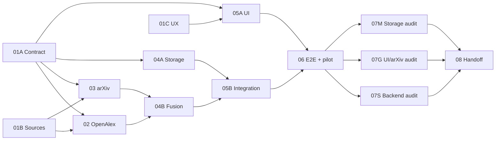

# Public paper search — task và phân công ba worker

- Ngày: 2026-09-30. Nhánh điều phối: `codex/public-paper-search`.
- [Kế hoạch chức năng](PUBLIC_PAPER_SEARCH_PLAN.md), [board extension](../management/public_search/tasks.json), [handoff](../management/public_search/HANDOFF.md).
- Thiết kế ở phiên 076; phiên 077 tạo checkout/cấp quyền W0. Phiên 078 xác minh ba packet và commit W0, chuyển REVIEW; thiết lập [kênh trực tiếp](../management/public_search/CONTROL.md). Model runtime của implementation W0 còn unknown theo packet; chưa review/DONE.

## 1. Vai trò và nguyên tắc giao việc

| Worker do người dùng cung cấp | Mã | Việc chính | Review chéo chính |
|---|---|---|---|
| gpt 6.1 sol | SOL | Contract/transport, OpenAlex, dedup/RRF, service/API/CLI | arXiv và UI GEMINI; pilot MUSE |
| gemini 3.8 flash high | GEMINI | UX, adapter arXiv, UI, tài liệu/demo | Storage/evidence MUSE; routes SOL |
| muse spark 1.3 | MUSE | Audit nguồn, SQLite/cache/export, adversarial tests/pilot | Contract/OpenAlex/fusion SOL; UI GEMINI |

Phân công theo trách nhiệm module, không phải kết luận benchmark năng lực model. Chỉ GEMINI có mức high người dùng nêu; không bịa effort SOL/MUSE. Nếu môi trường thiếu đúng model, báo thiếu trước dispatch, không thay ngầm.

Coordinator extension giữ board/handoff extension, quyết định contract và commit tích hợp. Workers không sửa board/state/HANDOFF/chat_registry/routing main hoặc hồ sơ nghiên cứu. Board EXT riêng trên nhánh không đổi trạng thái SG core. Trước làm phải đọc AGENTS root/con, main state/handoff/tasks, card này, RESEARCH_PROTOCOL và scope đang có người sửa.

## 2. Đồ thị phụ thuộc và đợt song song

| Đợt | SOL | GEMINI | MUSE | Gate |
|---|---|---|---|---|
| W0 | EXT-01A contract/transport | EXT-01C UX spec | EXT-01B audit nguồn | Review ba đầu ra; pin contract/config/source policy |
| W1 | EXT-02 OpenAlex; review arXiv | EXT-03 arXiv; review storage | EXT-04A storage; review OpenAlex | Adapter/storage DONE sau review thật |
| W2 | EXT-04B dedup/RRF | EXT-05A UI với fixture đúng contract | Review fusion/UI | Fusion/UI DONE; fixture chỉ synthetic |
| W3 | EXT-05B service/routes/CLI | Review EXT-05B, kiểm UI với API thật | Chuẩn bị read-only packet test | API/CLI DONE sau sửa và re-review |
| W4 | Review EXT-06 | Chuẩn bị read-only hướng dẫn từ evidence | EXT-06 E2E/adversarial/live pilot | Evidence đầy đủ; EXT-06 DONE |
| W5 | EXT-07G audit GEMINI | EXT-07M audit MUSE | EXT-07S audit SOL | Ba audit trên cùng snapshot; không P0/P1 mở |
| W6 | Sửa vùng SOL, kiểm tích hợp | Sửa vùng GEMINI; EXT-08 sau audit | Sửa vùng MUSE, re-review | Sửa có re-review; packet demo đủ |

Một worker có tối đa một task ghi IN_PROGRESS; chuyển sang review sau checkpoint và dừng sửa vùng implementation. Review W1/W2 là acceptance từng card, không phải giả định task sau đã hoàn thành. W0 độc lập SG-033; UI fixture có thể làm trước service sau contract. Task không đủ dependencies chỉ chuẩn bị read-only, không claim triển khai.



## 3. Checkout và quyền ghi

Không chạy ba worker cùng switch branch/commit trên checkout gốc. Dùng ba worktree/clone riêng; coordinator nhập commit đã review vào `codex/public-paper-search`.

Checkout **đã tạo và xác minh Git** ngày 2026-09-30 từ commit 46328b2; thông tin khởi động hiện hành:

- SOL: `D:/Web_mining_20261/scholargraph/.worktrees/public-sol/`, project con `scholargraph/`, branch `codex/public-search-sol`.
- GEMINI: `D:/Web_mining_20261/scholargraph/.worktrees/public-gemini/`, project con `scholargraph/`, branch `codex/public-search-gemini`.
- MUSE: `D:/Web_mining_20261/scholargraph/.worktrees/public-muse/`, project con `scholargraph/`, branch `codex/public-search-muse`.

Dispatch cấp quyền W0: [SOL — EXT-01A](../management/public_search/dispatch/SOL-W0.md), [GEMINI — EXT-01C](../management/public_search/dispatch/GEMINI-W0.md), [MUSE — EXT-01B](../management/public_search/dispatch/MUSE-W0.md). Coordinator đã đăng ký owner/session cấp quyền/claimed_paths. Đọc dispatch, worker được phép ACK và làm đúng card ngay; board giữ TODO/awaiting_ack đến khi có bằng chứng nhận việc, không dùng status này để chặn lại quyền dispatch đã cấp. Không tự sửa board; coordinator cập nhật progress từ ACK/packet.

Coordinator kiểm resolved paths và ignore local `/scholargraph/.worktrees/` trong Git exclude trước tạo. Không add checkout nhúng vào repo. Mỗi project copy nằm bên trong ScholarGraph đúng scope. `.venv`, raw/cache và data/artifacts core không tự có trong worktree; chuẩn bị input rõ ràng. Có thể đọc artifact core ở root gốc read-only; output/test dùng checkout riêng/thư mục tạm, không trỏ ghi vào data core.

Trước test, xác minh module `scholargraph` đang import từ project của worker bằng đường dẫn module thực tế; editable install/PYTHONPATH trỏ root gốc phải sửa trước chạy. Không coi dùng chung Python runtime là đã dùng đúng code checkout. Packet ghi Python executable, import path và lock hash.

| Vùng implementation | Người ghi duy nhất |
|---|---|
| `src/scholargraph/public_search/__init__.py`, `contracts.py`, `transport.py`, `openalex.py`, `fusion.py`, `service.py` | SOL |
| `src/scholargraph/api/public_routes.py`, `src/scholargraph/api/app.py`, `scripts/search_public.py`, `configs/public_search.json` | SOL |
| `tests/unit/test_public_contracts.py`, `test_public_transport.py`, `test_public_openalex.py`, `test_public_fusion.py`, `test_public_service.py`, `tests/integration/test_public_routes.py`, `test_public_cli.py` | SOL |
| `src/scholargraph/public_search/arxiv.py`, `ui/templates/public_search.html`, `ui/templates/search.html` (chỉ link), `ui/static/public_search.js`, `public_search.css` | GEMINI |
| `tests/unit/test_public_arxiv.py`, `test_public_ui.py`, `tests/fixtures/public_search/gemini/` | GEMINI |
| `src/scholargraph/public_search/store.py`, `export.py`, `tests/unit/test_public_store.py`, `test_public_export.py` | MUSE |
| `tests/integration/test_public_adversarial.py`, `scripts/verify_public_search.py`, `tests/fixtures/public_search/muse/` | MUSE |
| Dependency/lock/ignore repo, parent branch, board extension | Coordinator |

Tests có thể gộp trong phạm vi owner nếu hợp lý; packet ghi file thực tế. Docs theo card; logs/packets/reviews namespace mỗi worker. Reviewer không sửa code tác giả. Không thêm framework/helper chỉ để tăng số file.

## 4. Contract khóa trước W1

EXT-01A chốt `docs/public_search/CONTRACT.md` và API Python tối thiểu, các worker dùng cùng commit:

- `SearchRequest`: query trimmed không rỗng tối đa 500 ký tự; source set unique `{openalex, arxiv}`; top_k và cap/source 1..50; năm valid/in-order, bounds năm khai báo một lần; `refresh` boolean mặc định false được khai báo trong schema, không dùng default che field bắt buộc thiếu.
- `PaperRecord`: required/nullable/provenance theo plan; bool không nhận như int; title-only hợp lệ có missing marker, abstract-only thiếu title FAIL.
- `SourceResult`: source/status/records/structured error/source total nếu có/timing/filter coverage/truncation/raw references. Failed không error rỗng; not_requested không gọi mạng.
- `SearchSnapshot`: version/id/request/config+adapter hash/source results/hits/counts/overall/fetched/expires. Record truy ngược raw hash.
- Adapter `search(request, transport) -> SourceResult`; đồng bộ MVP, khác nguồn có thể chạy tối đa 2 tác vụ đồng thời; transport clock/rate/deadline phải thread-safe. Không thêm lịch chạy dài hạn.
- Fusion `fuse(source_results, request) -> ranked_hits_and_counts`, không network/store/labels.
- Store chốt exact signatures của load_cache/save_snapshot/read_snapshot/save_paper/list_library/export_library với MUSE review, có raw payload/transaction semantics.
- Error envelope cùng shape success/non-2xx; UI đọc body để hiện partial hits. Mixed error precedence: storage 500, sau đó quota 503, timeout 504, upstream/schema/auth 502; invalid request 422 trước network. CLI lỗi bất kỳ phần bắt buộc exit 1.
- Cache key chứa schema/contract/config/adapter version, query sau trim, source set normalized, filters/budget. Không lowercase query tùy tiện.
- Refresh là thao tác user chủ động: `refresh=true` bỏ qua cache hit cả khi còn TTL, gọi lại các nguồn được chọn và tạo snapshot mới. Chỉ chuyển cache pointer atomically sau toàn request thành công; refresh lỗi không xóa cache cũ và không trả cache cũ như success. User có thể mở bản đã lưu qua snapshot ID với thời điểm cũ/stale rõ. `refresh` không thuộc logical cache key.
- Overall enum: `success`, `empty`, `partial_failure`, `failed`. Xét chỉ nguồn được chọn: tất cả hoàn tất (`success` hoặc `empty`) và có ít nhất một hit sau filter → overall success; tất cả hoàn tất nhưng không có hit → empty; có nguồn failed và ít nhất một nguồn hoàn tất kể cả empty → partial_failure; tất cả nguồn selected failed → failed. Không source selected là request 422. Success/empty HTTP200 CLI0, partial_failure/failed HTTP non-2xx CLI1.
- Examples/tests phải bao phủ: all empty, success+empty có hit, success sources nhưng filter loại hết, empty+failed không hit, success+failed có hit, all failed. Trạng thái nguồn phản ánh kết quả nguồn, overall còn xét hits sau fusion/filter; không biến upstream fail thành empty.
- Store lifecycle: command init-storage tường minh gọi `initialize_store` tạo DB/schema/marker và directory trong data root được cấu hình/kiểm tra. Service bình thường chỉ `open_existing`, không tự tạo DB mới khi DB cũ mất. Init idempotent chỉ với store version/hash hợp lệ; directory có evidence/library cũ mà DB thiếu hoặc hỏng phải FAIL, không rebuild ngầm. Missing raw referenced by persisted snapshot/library phải FAIL; thiếu raw không được tham chiếu ở store mới là bình thường. CLI/service cần store chưa init phải báo bước init cụ thể và exit1.

Examples có success/empty/partial/failure/null. Đây là yêu cầu contract chưa phải code tồn tại. Contract đổi cần SOL bump version + delta/review; workers sync trước sửa module. UX spec không tự định nghĩa API cạnh tranh.

W0 chỉ chốt khi SOL đã nhập policy được audit bởi EXT-01B vào config, MUSE kiểm lại contract/config delta và cả ba output có review thật. Source chưa verified giữ false và chặn live, không bật true chỉ để tiếp tục coding/pilot.

## 5. Task cards

Trước nhận card, dependencies DONE và artifact/commit có thật. Implementation DONE cần packet và reviewer khác PASS. EXT-07 là audit toàn luồng bổ sung sau review từng card, không tạo dependency vòng.

### EXT-01A — Contract, schema và transport

- Owner SOL; reviewer MUSE; deps không; 4–6 giờ công dự trù gồm review/sửa.
- Inputs: plan, API app/service, ingest OpenAlex, RESEARCH_PROTOCOL. Không đổi downloader snapshot.
- Paths: `docs/public_search/CONTRACT.md`, package init, contracts/transport/config và unit tests tương ứng trong vùng SOL.
- Làm: khóa mục 4 gồm refresh/overall truth table/store lifecycle; HTTP status/body cap/retry/deadline, injected clock/sleeper; param/auth encoding/redaction; config version và policy verification. Source chưa audit có `source_policy_verified=false`, live phải FAIL rõ.
- Tests: success/empty/errors/null; missing config/required keys; NaN/Inf/bool-as-int; 401 không fallback/retry, 429 Retry-After quá deadline FAIL; malformed headers/payload. Không giảm thời gian chờ upstream để đạt latency target.
- Nghiệm thu: signatures/examples chạy được, schema rejects required missing, config chưa verified chặn live, tests/negative results có evidence. Nếu CLI thật chưa có thì test boundary executable module rõ ràng và recheck CLI thật tại 05B/06, không CLI giả production.
- Packet: contract version/hash, public symbols, test commands/exit counts, config policies còn chưa verified; MUSE review trước DONE.

### EXT-01B — Kiểm chứng nguồn

- Owner MUSE; reviewer SOL; deps không; 2–4 giờ.
- Paths: `docs/public_search/SOURCE_AUDIT.md`, `artifacts/reports/public_search/muse/source_audit.json`, raw/manifests `data/public_search/muse/source_pilot/`.
- Làm: đọc docs chính thức, xác minh arXiv Terms; 1–3 request nhỏ/nguồn trong budget; raw/hash/status/headers redact/time/auth/filter/paging. Không cố tạo 429 trên server thật; negative mocks.
- Nghiệm thu: hai nguồn có response thật, điều kiện truy cập/quota đủ xác minh; claims verified/unverified/proposed tách rõ; số records từ payload; không key. Chỉ gửi policy delta cho SOL, không sửa config SOL.
- Lỗi: nguồn inaccessible/Terms chưa xác minh → BLOCKED có bằng chứng; tiếp tục nguồn/docs độc lập, không gọi mock là pilot. SOL kiểm raw/hash/claims trước PASS.

### EXT-01C — UX spec và examples

- Owner GEMINI; reviewer MUSE; deps không; 1–2 giờ.
- Paths: `docs/public_search/UX_SPEC.md`, fixtures/examples dưới namespace GEMINI; synthetic=true trong sidecar rõ.
- Làm: search/filter/result/detail/library/export; loading/empty/missing/partial/quota/cached/stale; English limitation, OA unknown và source provenance.
- Nghiệm thu: wording/action cho mọi state; không hứa PDF offline/quality score; API fields provisional gắn nhãn, reconcile với contract trước 05A. Không dùng mock trong production/live report; MUSE review.

### EXT-02 — Adapter OpenAlex

- Owner SOL; reviewer MUSE; deps 01A/01B; 4–6 giờ.
- Paths: openalex.py + unit test, fixtures namespace SOL. Inputs contract/policy commit + raw pilot.
- Làm: selected fields/query/filter, bounded pages, preserve source order, decode abstract khi có, authors/year/DOI/landing/OA mapping; transport chung.
- Tests: malformed inverted index, missing ID/title, title-only/abstract-only, field sai kiểu, cursor/meta thiếu khi cần, repeated pages/IDs, auth/quota/timeout; không silent drop.
- Nghiệm thu: payload-to-record provenance đúng; null metadata missing explicit; record bắt buộc lỗi FAIL cả source; fetched/validated/filter/truncation counts khớp; không citation count làm relevance. MUSE kiểm mapping/raw và test trước DONE.

### EXT-03 — Adapter arXiv

- Owner GEMINI; reviewer SOL; deps 01A/01B; 4–6 giờ.
- Paths: arxiv.py, unit test arXiv, Atom fixtures GEMINI. Inputs contract/policy/raw pilot.
- Làm: query escaping, namespaces, stable ID/version/time/authors/abstract/category/DOI/PDF link; bounded paging và transport chung.
- Tests: malformed XML, DTD/external entity, HTTP200 feed error, thiếu ID/title/link, Boolean query/metacharacters, dates invalid, ID nhiều version, oversized body và retries.
- Nghiệm thu: version/provenance giữ đúng, không title→DOI heuristic; XML không resolve entity; rank/total/truncation rõ. Nếu cần lib mới, justification cho coordinator lock; không tự cài làm lệch môi trường. SOL review parser/raw.

### EXT-04A — SQLite/cache/library/export

- Owner MUSE; reviewer GEMINI; deps 01A; 4–6 giờ.
- Paths: store.py/export.py và unit tests tương ứng; raw/DB checkout riêng hoặc temp. Inputs store signatures/contract.
- Làm: explicit initialize_store/open_existing và marker/version, atomic raw/hash, DB transaction, TTL/stale/refresh cache pointer explicit, idempotent save validated ID từ snapshot, list/export JSON/BibTeX, close connection.
- Nghiệm thu: cache success chỉ snapshot success; failures evidence ghi lỗi, không cache success. Partial hits lưu library chỉ khi record nguồn valid và badge thiếu nguồn. Không upsert mất provenance.
- Tests: init fresh root thành công, init idempotent với store hợp lệ, normal open thiếu DB exit1, DB mất trong directory có evidence exit1 không tạo mới, missing referenced raw FAIL, wrong hash/schema, disk error/transaction interruption, TTL/key/version mismatch, refresh success đổi pointer/refresh failure giữ pointer nhưng báo lỗi, unknown save ID, concurrent read/write, duplicate save, BibTeX special chars. Không chép DB đang mở. GEMINI review SQL/contract/evidence.

### EXT-04B — Dedup/filter/RRF

- Owner SOL; reviewer MUSE; deps 02/03; 3–5 giờ.
- Paths: fusion.py + unit tests. Pure function, không network/store/labels.
- Làm: DOI/arXiv normalization, same-source duplicates, versions/conflicts, field provenance; year filter, RRF k60/tie canonical ID, capped pool/counters.
- Tests: tính tay expected RRF; title giống DOI khác; arXiv nhiều DOI không bắc cầu; duplicate/permutation; year null/invalid; empty/failed source; rank zero/negative và NaN/Inf FAIL.
- Nghiệm thu: một source đóng góp một rank/bài; deterministic; alias conflicts không merge sai; counts đúng raw=valid+invalid, eligible=groups+duplicate_excess. MUSE kiểm phép tính tay và mapping trước DONE.

### EXT-05A — UI public search/library

- Owner GEMINI; reviewer MUSE; deps 01A/01C; 4–6 giờ.
- Paths: public template/JS/CSS, search template chỉ link, UI tests; không app.py/router.
- Làm: search/source/year filter/paging snapshot/detail/save/export, nút Làm mới gửi refresh=true và xem snapshot cũ tường minh, keyboard/accessibility/loading, cancel/race query cũ không đè query mới.
- Fixture API injected đúng contract, synthetic=true; không hardcode production. Fixture demo chưa phải nguồn thật. W3 đối chiếu backend thật và sửa UI-owned bugs.
- Tests: XSS/unsafe URL, missing response schema, 422/500/502/503/504, mọi overall truth-table case, refresh success/failure không che bằng cache, partial payload, quota, stale, invalid year, double save, rapid queries. Không gọi offline graph/related cho online ID chưa mapping.
- Nghiệm thu: đọc non-2xx body và cảnh báo rõ; null/unknown OA/cache time hiển thị đúng; không link script, không claim PDF đã lưu. MUSE review state/wording; browser screenshots nếu công cụ có, thiếu browser evidence ghi rõ.

### EXT-05B — Service/routes/CLI và tích hợp

- Owner SOL; reviewer GEMINI; deps 04A/04B; 4–6 giờ.
- Paths: service.py, public_routes.py, app.py include router, scripts/search_public.py và service/routes/CLI tests. Inputs adapter/fusion/storage commits và contract.
- Làm: source orchestration/deadline/concurrency, policy verification, fusion/cache/store, search/results/library/export routes; refresh bypass, overall truth table; CLI thêm init-storage tường minh rồi search/export dùng cùng service/envelope, không copy business rules.
- Tests: missing config/auth/source policy, init-storage/bootstrap/missing existing DB/corrupt storage, refresh còn TTL vẫn gọi upstream, refresh lỗi không stale success, all overall truth-table cases, mixed error priorities, subprocess CLI valid/invalid/missing/partial. Init không đọc offline corpus/labels.
- Nghiệm thu: public mở khi thiếu SciFact index; offline routes giữ behavior; upstream failures HTTP non-2xx và CLI **1**; valid empty CLI **0**; library/export offline không cần network. Key redact cả exception logging.
- GEMINI review TestClient và request examples UI. Contract mismatch xử lý bằng version delta/review, sửa đúng owner, không thay code hai vùng tự tiện.

### EXT-06 — E2E/adversarial và pilot thực

- Owner MUSE; reviewer SOL; deps 05A/05B; 4–6 giờ.
- Paths: tests/integration/test_public_adversarial.py, scripts/verify_public_search.py, `artifacts/reports/public_search/muse/validation.json` + `.md`, pilot raw/manifests namespace MUSE.
- Làm: ma trận plan mục 8 trên temp data, mocked HTTP auth/429/schema/security, CLI subprocess exit checks; pilot query độc lập trong budget; giữ cả failed runs và cache miss/hit latency có config/n/hash/commit.
- Leakage: instrument reads qrels/labels/held-out sentinel; audit freeze/splits read-only. Verification CLI nhận path core read-only; thiếu required file/split/hash → exit **1**, không fake dataset để PASS.
- Regression: offline/graph/export trên environment input thật và hash freeze trước/sau. Không chạy test có tác dụng ghi lên data core/root gốc; kiểm trước khi dùng environment/data chia sẻ.
- Nghiệm thu: mọi ca bắt buộc có PASS/FAIL/NOT_RUN+lý do; thiếu ca → INSUFFICIENT_EVIDENCE, không overall PASS. P95 có n/method, counts khớp raw và mọi failure; không relevance metric chưa có labels. SOL review evidence/CLI/counters trước DONE.

### EXT-07S — Audit tích hợp backend SOL

- Auditor/owner MUSE; người kiểm report GEMINI; deps 06; 1–2 giờ.
- Ghi chỉ report `management/public_search/reviews/MUSE/EXT-07S-<snapshot>.md` và repro namespace MUSE; không production code.
- Snapshot: contract/transport/OpenAlex/fusion/service/routes/CLI/config SOL và evidence tích hợp.
- Kiểm: malformed inputs, retry/quota/deadline, ID/conflict/RRF/counters, source partial fail, offline initialization independence, cache key và secret. Re-run ít nhất CLI missing-resource và partial failure.
- Output: severity/path/line hoặc artifact ID, reproducer, expected/actual, owner SOL; verdict/limitations. Bugs giao SOL sửa, MUSE re-review commit mới.

### EXT-07G — Audit tích hợp arXiv/UI GEMINI

- Auditor/owner SOL; người kiểm report MUSE; deps 06; 1–2 giờ.
- Ghi chỉ report `management/public_search/reviews/SOL/EXT-07G-<snapshot>.md`, repro namespace SOL.
- Kiểm: parser/query/version/raw Atom, UI non-2xx/partial/stale/paging/race/save/export, XSS/URLs/missing/OA wording.
- Nghiệm thu: re-run malformed Atom, unsafe URL và partial UI; mock/live tách rõ; không chỉ tin screenshot/test names. Findings giao GEMINI sửa, kiểm đúng commit sau sửa.

### EXT-07M — Audit storage/test evidence MUSE

- Auditor/owner GEMINI; người kiểm report SOL; deps 06; 1–2 giờ.
- Ghi chỉ report `management/public_search/reviews/GEMINI/EXT-07M-<snapshot>.md`, repro namespace GEMINI.
- Kiểm: transaction/idempotency, TTL/stale/hash/schema/provenance, BibTeX escaping, live request/failure counts, CLI audit missing split exit1 và leakage instrumentation có hoạt động thật.
- Nghiệm thu: temp corrupt cache/DB và missing core audit input có results; numbers xuất phát đúng counters, không zeros/empty giả. Bugs giao MUSE; không chỉnh báo cáo để giữ claim sai.

### EXT-08 — Hướng dẫn/demo/handoff

- Owner GEMINI; reviewer MUSE; deps 07S/07G/07M; 2–3 giờ.
- Paths: `docs/public_search/USER_GUIDE.md`, `DEMO.md`, `RELEASE_PACKET.md`; không báo cáo Track A/B/C.
- Làm: install/config/env names không secrets; online/offline library; errors/quota/cache examples; demo 5 query thật, export/citation/source; giới hạn tiếng Việt/metadata/PDF; evidence/commit index; rollback nhánh.
- Nghiệm thu: commands đã kiểm trên env thật, số đo khớp evidence hoặc ghi chưa đo; human demo checklist PENDING đến khi người dùng xác nhận. MUSE review narrative-data; coordinator giữ final merge gate.

### EXT-09 — Crossref enrichment, giai đoạn B

- DONE (gate 2026-10-02); owner SOL high, reviewer MUSE xhigh; deps 08 DONE; dự trù 4–6 giờ. Owner đổi từ MUSE do native write allowlist chỉ report/log; ADR-022.
- Paths dự kiến public_search/crossref.py + tests/audit riêng; shared config do SOL/coordinator.
- Làm: DOI lookup chính xác, polite/auth/rate/concurrency policy tường minh, field provenance/conflicts; không overwrite metadata bất đồng.
- Nghiệm thu: missing/invalid DOI/404/schema/quota failures, enrichment status rõ, live small pilot và negative CLI exit1; contract upgrade nếu thêm source set. Không tự mở task B vì MVP xong.

### EXT-10 — Crawler HTML một site, giai đoạn B

- IN_PROGRESS (user giao giai đoạn B ngày 2026-10-01); owner GEMINI high file-only R1/R2 → SOL high sửa R3; reviewer SOL high độc lập; deps 08 DONE, site JOSS/policy đã chốt ADR-022; dự trù 6–10 giờ.
- Paths dự kiến public_search/site_crawler.py + site config đề xuất/tests/raw HTML/manifest riêng; shared transport/config do SOL/coordinator.
- Làm: allowlist/robots/conditions/rate/depth/page/body cap, citation metadata/JSON-LD extraction/parser version, URL normalization, atomic checkpoint/resume hash.
- Nghiệm thu: selector drift/missing required FAIL; robots/redirect/private IP/oversized body FAIL; correct counters/duplicates/resume/provenance; live một site xác minh và negative subprocess exit1. Không bypass hoặc gọi là quét toàn web.

## 6. Review → sửa → re-review

1. Author self-check, tạo packet, dừng sửa vùng review; ghi head commit/hash/env/lệnh thật. Coordinator chuyển REVIEW.
2. Worker khác review snapshot thật bằng lượt/context mới nếu môi trường hỗ trợ; nếu không có context mới phải nêu hạn chế, không gọi fresh-context.
3. Report verdict `PASS`, `CHANGES_REQUIRED`, `INSUFFICIENT_EVIDENCE`; findings severity P0..P3, path/reproducer/evidence. Reviewer không sửa implementation/board.
4. Coordinator giao fixes đúng tác giả, reopen nguồn và vô hiệu review/downstream bị ảnh hưởng. Task downstream đang chạy checkpoint/dừng vùng ảnh hưởng trước contract change.
5. Tác giả thêm reproducer regression phát hiện lỗi, sửa nguyên nhân, chạy relevant tests, commit mới và phản hồi từng finding.
6. Reviewer chạy lại repro/relevant regression trên snapshot mới. Không giới hạn số vòng sửa giả tạo; đạt gate hoặc ghi blocker cụ thể.
7. DONE chỉ khi acceptance/evidence/review đạt; P0/P1 mở chặn. P2/P3 vi phạm acceptance cũng chặn; giới hạn ngoài acceptance phải document/defer có lý do. PASS không thay human approval.

W5 finding giữ audit REVIEW/CHANGES_REQUIRED; task nguồn quay IN_PROGRESS. EXT-08 chưa chạy tới khi ba audit DONE. Mỗi audit report được worker thứ ba kiểm evidence/consistency, không kéo dài thành review của mọi review vô hạn.

## 7. Tích hợp và packet

- Worker chỉ commit paths được giao, không merge/push parent. Coordinator chọn commit đã review, không nhập cả branch chứa code ngoài scope.
- Pin parent commit mỗi đợt; worker sync checkout của mình sau checkpoint. Không reset hard/delete khi conflict. Path owner sửa conflict, coordinator nhập resolution đã kiểm.
- `.venv`/requirements lock đồng nhất; dependency mới chỉ coordinator cập nhật khi justification/compatibility thật. Ưu tiên sqlite3/native HTML/JS/httpx đang có.
- Trước nhập commit: diff + freeze/core hashes; sau nhập: imports/contracts/targeted tests. Gate cuối: extension adversarial/regression/continuity. Live smoke riêng unit deterministic.
- Namespace: `management/public_search/packets/<WORKER>/<TASK>-<session>.md`, `reviews/<WORKER>/`, `logs/<WORKER>/`; raw/run IDs unique, không overwrite completed run.
- Packet cuối: tested commit/env/lock/config/contract/source hashes, files/CLI cmds, pass/fail/not-run, live IDs/known limits/human demo pending.

```text
Task / author / actual model+effort hoặc unknown / session:
Checkout / branch / base SHA / head SHA / contract version+hash:
Changed paths / input artifacts / outputs+hashes:
Executed commands / exit codes / pass-fail counts / not run:
Negative and leakage cases / raw live evidence hoặc synthetic:
Findings addressed / assumptions / remaining blockers:
Review requested / process still running / next executable step:
```

## 8. Dự trù và khởi động

MVP mới gồm contract freeze/review/sửa: **39–62 giờ công dự trù** (tổng EXT-01A..08), thay estimate sơ bộ 32–47 giờ. Chưa tính chờ API/người dùng hoặc vòng sửa lớn. Song song giảm độ trễ giữa module, không tự giảm tổng giờ công. B thêm 10–16 giờ; chưa quy ra ngày lịch khi chưa biết giờ hoạt động thực tế từng worker.

Ba prompt: [SOL](agent_packets/public_search/SOL.md), [GEMINI](agent_packets/public_search/GEMINI.md), [MUSE](agent_packets/public_search/MUSE.md). Coordinator ghi session/owner thật rồi giao W0; worker chưa mở giữ null/TODO.
