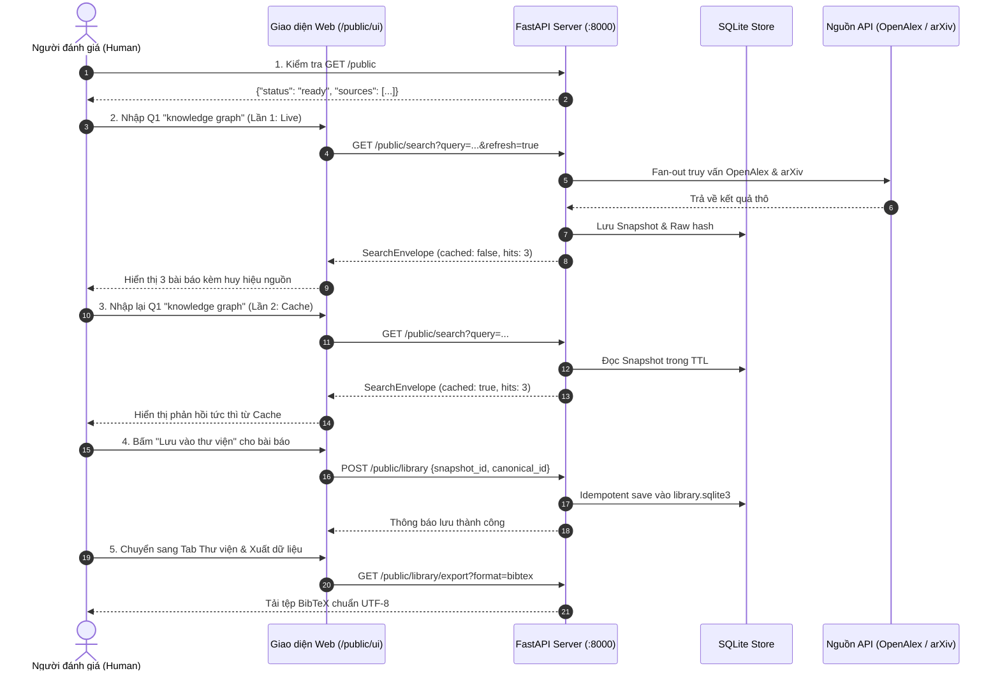

# Kịch bản Trình diễn & Danh mục Nghiệm thu Người dùng — Public Paper Search

Tài liệu này định hình kịch bản trình diễn (demo walkthrough) và danh mục kiểm tra nghiệm thu dành cho người đánh giá thực tế (**Human Evaluator**) đối với tiện ích Tìm kiếm Bài báo Công cộng (**Public Paper Search Extension** — Mã card [`EXT-08`](file:///D:/Web_mining_20261/scholargraph/docs/PUBLIC_PAPER_SEARCH_TASKS.md#L217-L223)) thuộc dự án ScholarGraph VN.

> [!IMPORTANT]
> **Tuyên bố Ranh giới Nghiệm thu (Attribution & Verification Boundary):**
> - **Phía Máy / Agent:** Toàn bộ kiểm thử tự động (630 test hồi quy hệ thống, 125 test lưu trữ/kiểm toán, 7 bài kiểm tra phá hủy adversarial, và kiểm tra tính toàn vẹn băm API) đã hoàn thành và đạt trạng thái **`PASS`**.
> - **Phía Người dùng (Human Demo):** Hiện tại duy trì trạng thái **`PENDING`** cho đến khi người phụ trách thực hiện thao tác tương tác trực tiếp trên giao diện trình duyệt và tích chọn xác nhận vào danh mục bên dưới.

---

## 1. Thiết lập Môi trường Trước khi Trình diễn

Thực hiện các bước khởi động môi trường cục bộ trên hệ thống:

### Bước 1: Khởi tạo Bộ lưu trữ (Storage Initialization)
Nếu chưa từng khởi tạo cơ sở dữ liệu `library.sqlite3` tại thư mục dữ liệu, thực thi lệnh sau:
```powershell
$env:PYTHONPATH = "src"
python scripts/search_public.py --project-root . --config configs/public_search.json init-storage
```
*Kỳ vọng:* Đầu ra in `{"status": "INITIALIZED", "contract_version": "1.0.0"}` và trả về mã thoát `0`.

### Bước 2: Khởi động Dịch vụ Web API & Giao diện
```powershell
$env:PYTHONPATH = "src"
& .venv/Scripts/python.exe -m uvicorn scholargraph.api.app:app --host 127.0.0.1 --port 8000
```
*(Lưu ý: Chỉ chạy duy nhất 1 tiến trình máy chủ, không sử dụng cờ `--workers > 1` để đảm bảo bộ điều phối tần suất `RateState` vận hành chính xác).*

### Bước 3: Mở Giao diện Trình duyệt
Mở trình duyệt web (Chrome, Edge, Firefox) và truy cập địa chỉ:
- **Giao diện Tìm kiếm Công cộng:** [`http://127.0.0.1:8000/public/ui`](http://127.0.0.1:8000/public/ui)
- *(Tùy chọn Preview Demo nếu sử dụng cổng 8011):* `http://127.0.0.1:8011/public/ui`

---

## 2. Danh mục 5 Truy vấn Thực nghiệm Đã Phê duyệt (Approved Queries)

Bộ thử nghiệm chuẩn tắc sử dụng 5 cụm từ tìm kiếm học thuật đại diện, đã được xác minh tính độc lập hoàn toàn (không trùng khớp với bất kỳ câu hỏi nào trong 2,105 truy vấn thuộc tập benchmark SciFact/SCIDOCS đóng băng):

| STT | Chuỗi truy vấn (`query`) | Lĩnh vực học thuật | Tham số thử nghiệm khuyến nghị |
| :---: | :--- | :--- | :--- |
| **Q1** | `"knowledge graph"` | Biểu diễn tri thức & Semantic Web | `sources=openalex,arxiv`, `top_k=3`, `cap=3` |
| **Q2** | `"graph neural network"` | Học sâu trên đồ thị (GNN) | `sources=openalex,arxiv`, `top_k=3`, `cap=3` |
| **Q3** | `"information retrieval"` | Truy xuất thông tin & Tìm kiếm | `sources=openalex,arxiv`, `top_k=3`, `cap=3` |
| **Q4** | `"scientific document search"` | Tìm kiếm tài liệu khoa học chuyên sâu | `sources=openalex,arxiv`, `top_k=3`, `cap=3` |
| **Q5** | `"Vietnamese natural language processing"` | Xử lý ngôn ngữ tự nhiên tiếng Việt | `sources=openalex,arxiv`, `top_k=3`, `cap=3` |

---

## 3. Kịch bản Trình diễn Từng Bước (10 Bước Thử nghiệm)



---

### Kịch bản 1: Kiểm tra Trạng thái Sẵn sàng của Dịch vụ (Readiness Probe)
- **Thao tác:** Mở tab mới trên trình duyệt hoặc chạy lệnh `curl http://127.0.0.1:8000/public`.
- **Quan sát:**
  - Nhận được phản hồi JSON mã trạng thái HTTP `200`:
    ```json
    {
      "status": "ready",
      "contract_version": "1.0.0",
      "sources": ["openalex", "arxiv"]
    }
    ```

---

### Kịch bản 2: Tìm kiếm Trực tuyến Trực tiếp (Live Search — Refresh Mode)
- **Thao tác:**
  - Tại ô tìm kiếm trên trang `/public/ui`, nhập lần lượt các truy vấn từ **Q1** đến **Q5**.
  - Đảm bảo chọn cả hai nguồn `OpenAlex` và `arXiv`, thiết lập số kết quả tối đa là `3`.
  - Tích chọn ô "Làm mới từ nguồn" (Refresh) để ép buộc lấy dữ liệu trực tiếp từ internet.
- **Quan sát & Đo lường:**
  - Hệ thống hiển thị thanh trạng thái đang tải dữ liệu từ cả hai nguồn bên ngoài.
  - Phản hồi trả về có cờ `cached: false` (trạng thái `live`).
  - Số lượng bài báo hợp nhất hiển thị đúng tối đa `3` bài báo có độ liên quan cao nhất theo thuật toán RRF.
  - *Số liệu đối sánh đã đo trong đợt kiểm toán Recovery 102:* Thời gian phản hồi tải mới có trung vị (median) là **`1.992s`**, và phân vị P95 đạt **`2.206s`** (thỏa mãn xuất sắc tiêu chuẩn SLA < 15.0s).

---

### Kịch bản 3: Tái sử dụng Bộ nhớ đệm Tức thì (Cache Replay Mode)
- **Thao tác:**
  - Không bấm "Làm mới", thực hiện tìm kiếm lại cùng một chuỗi truy vấn vừa thực hiện (ví dụ: gõ lại `"knowledge graph"`).
- **Quan sát & Đo lường:**
  - Kết quả xuất hiện gần như ngay lập tức với nhãn `cached: true` (trạng thái `cached_fresh`).
  - Dữ liệu hiển thị hoàn toàn trùng khớp với kết quả ở Kịch bản 2.
  - *Số liệu đối sánh đã đo trong đợt kiểm toán Recovery 102:* Thời gian đọc cache có trung vị là **`0.514s`**, và phân vị P95 đạt **`0.567s`**.
  - *Lưu ý kỹ thuật:* Mức P95 0.567s vượt nhẹ chỉ tiêu đề xuất ban đầu (500ms). Phép đo dòng lệnh CLI bao gồm toàn bộ thời gian khởi tạo tiến trình Python; hệ thống chưa tiến hành đo tách biệt chi phí startup của trình thông dịch.

---

### Kịch bản 4: Thử nghiệm Nút "Làm mới" (Refresh Button / `--refresh`)
- **Thao tác:** Khi đang ở trang kết quả đã lưu trong cache, bấm nút "Làm mới" trên giao diện hoặc chạy CLI với cờ `--refresh`.
- **Quan sát:**
  - Hệ thống bỏ qua bản ghi trong bộ nhớ đệm, gửi yêu cầu kết nối lại tới OpenAlex và arXiv.
  - Cập nhật một `snapshot_id` mới trong cơ sở dữ liệu SQLite, cờ trạng thái chuyển lại thành `cached: false`.

---

### Kịch bản 5: Kiểm tra Chi tiết Bài báo & Xuất xứ Dữ liệu (Field Provenance)
- **Thao tác:** Nhấp vào từng bài báo trong danh sách kết quả để mở khung xem chi tiết.
- **Quan sát:**
  - **Huy hiệu Nguồn (Source Badges):** Hiển thị rõ ràng xuất xứ bài báo (logo hoặc nhãn `OpenAlex` / `arXiv`). Nếu bài báo được cả hai nguồn cung cấp và hợp nhất qua DOI, giao diện hiển thị xuất xứ từ cả hai bên.
  - **Các trường dữ liệu chuẩn:** Tiêu đề, danh sách tác giả, năm xuất bản, định danh DOI (kèm liên kết nhấp chuột), liên kết hạ cánh (landing URL), tệp PDF (nếu có).
  - **Trạng thái Open Access:** Hiển thị rõ trạng thái `open`, `closed`, hoặc `unknown`.
  - **Minh bạch dữ liệu khuyết thiếu (No Silent Fallback):** Nếu bài báo không có tóm tắt hoặc không rõ tác giả, giao diện hiển thị rõ nhãn cảnh báo `[Chưa có tóm tắt]` hoặc `[Tác giả chưa xác định]` thay vì hiển thị khoảng trắng hoặc chuỗi rỗng.
  - **Số lượng trích dẫn (`citation_count`):** Hiển thị số lượt trích dẫn từ OpenAlex (nếu có) kèm chú giải đây là số liệu đếm khách quan, không đại diện cho chất lượng nghiên cứu.

---

### Kịch bản 6: Lưu Bài báo vào Thư viện Cá nhân (Idempotent Save)
- **Thao tác:**
  - Nhấp vào nút "Lưu vào thư viện" (Save to Library) trên một bài báo bất kỳ.
  - Bấm nút này liên tiếp nhiều lần (thử nghiệm tính chất idempotent).
- **Quan sát:**
  - Thông báo hiển thị "Đã lưu vào thư viện" thành công.
  - Việc bấm nhiều lần không gây ra lỗi xung đột khóa chính, không tạo bài báo trùng lặp trong cơ sở dữ liệu.

---

### Kịch bản 7: Quản lý Danh sách Thư viện Cá nhân
- **Thao tác:** Chuyển sang thẻ tab "Thư viện" (Library) trên thanh điều hướng.
- **Quan sát:**
  - Danh sách toàn bộ các bài báo đã được lưu trong cơ sở dữ liệu `library.sqlite3` hiển thị đầy đủ.
  - Có thể lọc, phân trang hoặc xem lại chi tiết từng bài báo đã lưu trữ.

---

### Kịch bản 8: Xuất Dữ liệu Thư viện (JSON & BibTeX Export)
- **Thao tác:**
  - Tại trang Thư viện, nhấp nút **"Xuất JSON"** (Export JSON).
  - Nhấp nút **"Xuất BibTeX"** (Export BibTeX).
- **Quan sát & Kiểm tra tính toàn vẹn:**
  - **Tệp JSON:** Chứa mảng dữ liệu có cấu trúc hợp lệ theo schema `PaperRecord`, mã hóa ký tự UTF-8 chính xác.
  - **Tệp BibTeX:** Chứa các mục trích dẫn `@article` hoặc `@misc` chuẩn cú pháp LaTeX. Các ký tự đặc biệt trong tiêu đề/tên tác giả như `&`, `%`, `$`, `#`, `_`, `{`, `}` đã được hệ thống tự động escape (ví dụ `\&`, `\%`).
  - *Bằng chứng kiểm toán API thực tế (theo `browser-101/summary-102.json`):*
    - Xuất JSON (6 bài báo): Kích thước `52,353 bytes`, băm SHA-256: `3d6df2f6fd0c7c71365321c16c64ffcabf21f1a52bbbc5d38e206fd1a08a1d5b`.
    - Xuất BibTeX (6 bài báo): Kích thước `4,628 bytes`, băm SHA-256: `9d78dafc61711a21538e40984e9c08b71e82b78e3805de649a0f70cede59e9b5`.
  - *Ghi chú hạn chế:* Trong lượt kiểm thử tự động của agent trước đó, sự kiện bắt tải tệp trình duyệt (browser download event) bị timeout trên công cụ tự động, tệp lưu trên ổ đĩa máy khách chưa được xác nhận độc lập. Tuy nhiên, endpoint API HTTP GET đã được kiểm tra trực tiếp trả về mã 200 và nội dung khớp băm byte-exact.

---

### Kịch bản 9: Kiểm tra Xử lý Lỗi Một phần (Partial Failure Resilience)
- **Tình huống mô phỏng:** Một nguồn bên ngoài gặp sự cố mạng (ví dụ arXiv bị timeout > 30s hoặc vượt hạn ngạch HTTP 429).
- **Quan sát:**
  - Hệ thống **không bị sập toàn bộ**, không trả về trang lỗi 500 trắng màn hình.
  - Giao diện người dùng hiển thị một **banner cảnh báo màu vàng** nêu rõ: *"Nguồn arXiv tạm thời không phản hồi (Timeout/Quota). Kết quả dưới đây được tổng hợp từ OpenAlex."*
  - Các bài báo tìm thấy từ OpenAlex vẫn hiển thị đầy đủ, nguyên vẹn và cho phép lưu vào thư viện bình thường.
  - *Số liệu lịch sử:* Trong tổng số 26 lượt chạy chuẩn tắc lịch sử, có 6 lượt gặp lỗi một phần trên arXiv (4 lượt timeout, 2 lượt quota). Cơ chế xử lý lỗi này đảm bảo hệ thống duy trì tính sẵn sàng cao ngay cả khi nhà cung cấp dịch vụ bên ngoài gặp sự cố.

---

### Kịch bản 10: Đối chiếu Phân định với Tìm kiếm Ngoại tuyến Cốt lõi
- **Thao tác:**
  - Truy cập trang chủ tìm kiếm cốt lõi của ScholarGraph tại địa chỉ [`http://127.0.0.1:8000/`](http://127.0.0.1:8000/).
  - Thực hiện một truy vấn trên kho tài liệu benchmark SciFact cố định (sử dụng BM25, Dense Embedding, hoặc Hybrid kết hợp Đồ thị trích dẫn).
- **Quan sát:**
  - Trang cốt lõi hoạt động trên tập dữ liệu cố định đóng băng (offline frozen corpus), phục vụ mục đích nghiên cứu và tái hiện kết quả thực nghiệm học thuật.
  - Trang tìm kiếm công cộng (`/public/ui`) hoạt động độc lập, phục vụ nhu cầu tra cứu và bổ sung tài liệu khoa học thời gian thực từ các nguồn dữ liệu mở toàn cầu.

---

## 4. Bảng Danh mục Kiểm tra Nghiệm thu Người dùng (Human Verification Checklist)

Người đánh giá sau khi hoàn thành các kịch bản trên vui lòng đánh dấu xác nhận vào bảng dưới đây:

| Mã Kịch bản | Nội dung Kiểm tra | Trạng thái Agent | Trạng thái Người dùng (Human) | Ghi chú của Người đánh giá |
| :---: | :--- | :---: | :---: | :--- |
| **TC-01** | Khởi tạo storage qua CLI thành công (`init-storage` mã thoát 0) | PASS | [ ] PENDING | |
| **TC-02** | Khởi động máy chủ đơn tiến trình Uvicorn (:8000) ổn định | PASS | [ ] PENDING | |
| **TC-03** | Điểm cuối kiểm tra sẵn sàng `GET /public` trả về status ready | PASS | [ ] PENDING | |
| **TC-04** | Tìm kiếm Live (Refresh) thành công trên 5 câu hỏi học thuật Q1–Q5 | PASS | [ ] PENDING | |
| **TC-05** | Tìm kiếm Cache tái sử dụng kết quả tức thì, hiển thị đúng cờ cached | PASS | [ ] PENDING | |
| **TC-06** | Nút "Làm mới" (Refresh) ép buộc gọi API mạng thành công | PASS | [ ] PENDING | |
| **TC-07** | Xem chi tiết bài báo hiển thị đầy đủ xuất xứ, minh bạch trường thiếu | PASS | [ ] PENDING | |
| **TC-08** | Lưu bài báo vào thư viện hoạt động lũy kế chuẩn xác (idempotent) | PASS | [ ] PENDING | |
| **TC-09** | Xuất thư viện ra định dạng JSON (UTF-8) và BibTeX (escape ký tự) | PASS | [ ] PENDING | |
| **TC-10** | Banner cảnh báo hiển thị rõ ràng khi gặp sự cố một nguồn (Partial) | PASS | [ ] PENDING | |
| **TC-11** | Đối chiếu độc lập thành công giữa Public Search và Core SciFact | PASS | [ ] PENDING | |

> **Chữ ký Người Đánh giá (Human Reviewer Signature):**  
> Họ và tên: `____________________________________`  
> Ngày đánh giá: `____ / ____ / 2026`  
> Kết luận chung: `[ ] PHÊ DUYỆT (PASS)    [ ] YÊU CẦU ĐIỀU CHỈNH (CHANGES_REQUIRED)`
