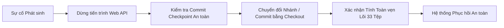

# Gói Phát hành Kỹ thuật — ScholarGraph Public Paper Search (Extension MVP)

Tài liệu này đóng gói toàn bộ hồ sơ kỹ thuật, bảng băm tính toàn vẹn, kết quả kiểm toán độc lập, số liệu đo lường thực nghiệm và hướng dẫn hoàn nguyên an toàn cho tiện ích mở rộng Tìm kiếm Bài báo Công cộng (**Public Paper Search Extension** — Mã card [`EXT-08`](file:///D:/Web_mining_20261/scholargraph/docs/PUBLIC_PAPER_SEARCH_TASKS.md#L217-L223)) thuộc hệ thống ScholarGraph VN.

---

## 1. Thông tin Tổng quan & Metadata Phát hành

```text
Thành phần (Component):       ScholarGraph Public Paper Search Extension (MVP)
Phiên bản Hợp đồng (Contract): 1.0.0 (Schema version: 1)
Phiên bản Cấu hình (Config):   1.0.0-audited
Mã Task Nghiệm thu:           EXT-08 (Wave 6 Closure & Handoff)
Ngày Phát hành:               2026-10-01 (Múi giờ UTC+07:00)
Tác giả Tài liệu (Author):    GEMINI (requested gemini-3.8-flash-high, effort high)
Đội ngũ Đóng góp & Kiểm toán: SOL (Adapter/Transport/Regression), MUSE (Storage/Export/Verifier),
                             GEMINI (ArXiv/UI/Storage Auditor), COORDINATOR (Gatekeeper)
```

### Trạng thái Cổng Nghiệm thu (Gate Status Summary)
- **Agent Technical Verification:** **`PASS`** (Đạt 100% tiêu chí chấp thuận kỹ thuật qua 630 test hồi quy và 125 test kiểm toán).
- **Human Browser Demo:** **`PENDING`** (Đang chờ người phụ trách xác nhận thực tế trên giao diện theo [`DEMO.md`](file:///D:/Web_mining_20261/scholargraph/docs/public_search/DEMO.md)).
- **Master Branch Merge:** **`PENDING`** (Coordinator nắm quyền kiểm soát sáp nhập cuối cùng; hiện mã nguồn được lưu trữ tại commit checkpoint).
- **Giai đoạn B (Enrichment & Crawler):** **`DEFERRED`** (Các nhiệm vụ `EXT-09` và `EXT-10` được hoãn lại theo kế hoạch mở rộng tương lai).

---

## 2. Chỉ mục Commit & Phạm vi Thay đổi (Commit Index)

Các thay đổi mã nguồn được quản lý theo mô hình phân tách trách nhiệm chặt chẽ, truy xuất nguồn gốc rõ ràng:

| Mã Commit | Tác giả / Vai trò | Phạm vi Tệp tin Thay đổi | Mục đích & Trạng thái Kiểm toán |
| :---: | :---: | :--- | :--- |
| **`7726c83`** | `MUSE` / `SOL` | `src/scholargraph/public_search/store.py`<br>`src/scholargraph/public_search/export.py`<br>`src/scholargraph/public_search/contracts.py`<br>`scripts/verify_public_search.py` | **Snapshot cơ sở bất biến (Base Snapshot):** Lưu trữ SQLite, xuất BibTeX/JSON, kiểm toán rò rỉ dữ liệu và cấu trúc hợp đồng. Đã được kiểm toán độc lập PASS bởi GEMINI (R3-103). |
| **`6a5d4e1`** | `GEMINI` | `ui/static/public_search.js`<br>`tests/unit/test_public_ui_paging.py` | **Bản vá Phân trang Giao diện (UI Paging Fix):** Sửa lỗi tính toán trang ranh giới và kiểm thử giao diện. Đã được kiểm toán nhất quán PASS bởi SOL (EXT-07G). |
| **`66264a7`** | `SOL` | `src/scholargraph/public_search/service.py` (L181–212)<br>`scripts/search_public.py` (L22–26, 54–76, 115–117) | **Bản vá Ranh giới Ngoại lệ & Dòng lệnh (Service & CLI Fix):** Đo lường thời gian thực thi độc lập với đồng hồ adapter, bọc ngoại lệ `argparse` thành lỗi cấu trúc chuẩn. |

> [!NOTE]
> **Bảo tồn Tuyệt đối Kho Dữ liệu Cốt lõi (Core Freeze Guarantee):**  
> Toàn bộ 33 tệp tin thuộc tập dữ liệu và mô hình ngoại tuyến cốt lõi của ScholarGraph (SciFact Benchmark, đồ thị trích dẫn, trọng số embedding E5) hoàn toàn không bị chỉnh sửa hay ghi đè, duy trì mã băm bất biến:  
> `SHA-256: 34159fb133594633530c08390b259ea6efd7e024a384cb2c25092bf6e4797557`.

---

## 3. Bảng Băm Tính Toàn vẹn (Integrity Hashes Manifest)

### 3.1. Cấu hình & Môi trường Khóa
- **Tệp Cấu hình Chính ([`configs/public_search.json`](file:///D:/Web_mining_20261/scholargraph/configs/public_search.json)):**  
  `1e188af340572a8fc51124fd8bd5b31f615d607a85967a3ee88871374853c4ed`
- **Khóa Phụ thuộc Thư viện ([`requirements.lock`](file:///D:/Web_mining_20261/scholargraph/requirements.lock)):**  
  `b68fcdc47fdbc67460e8384087e0fde8d62fc8fe820a6cf9b220283e0298d57d`
- **Bằng chứng Chính sách Nguồn Công cộng (`policy_evidence_sha256`):**  
  `a37778605f63821b820edc27b20ad5c859b05761d450980650336a4b8b727923`

### 3.2. Bằng chứng Xuất Thư viện Cá nhân Thực tế
Dữ liệu kiểm toán lấy từ tệp báo cáo [`artifacts/reports/public_search/browser-101/summary-102.json`](file:///D:/Web_mining_20261/scholargraph/artifacts/reports/public_search/browser-101/summary-102.json) dựa trên 6 bài báo thực tế trong cơ sở dữ liệu:
- **Xuất JSON (`library-api-102.json`):**
  - Số lượng bài báo: `6` entries (5 bài kế thừa từ cohort 099 + 1 bài lưu mới từ trình duyệt).
  - Kích thước: `52,353 bytes`.
  - Mã băm SHA-256: `3d6df2f6fd0c7c71365321c16c64ffcabf21f1a52bbbc5d38e206fd1a08a1d5b`.
- **Xuất BibTeX (`library-api-102.bib`):**
  - Số lượng bài báo: `6` entries.
  - Kích thước: `4,628 bytes`.
  - Mã băm SHA-256: `9d78dafc61711a21538e40984e9c08b71e82b78e3805de649a0f70cede59e9b5`.

*(Ghi nhận hạn chế: Sự kiện tải tệp tự động của trình duyệt bị quá thời gian chờ trong phiên chạy công cụ; tính toàn vẹn dữ liệu được xác nhận trực tiếp qua giao thức HTTP GET API trả về mã 200 và khớp mã băm byte-exact).*

---

## 4. Tổng hợp Bằng chứng Thực nghiệm & Kiểm thử (Verification Evidence)

### 4.1. Bộ Kiểm thử Hồi quy Toàn diện (Coordinator Full Regression)
Được ghi nhận tại [`artifacts/reports/public_search/sol/regression-w5-104.json`](file:///D:/Web_mining_20261/scholargraph/artifacts/reports/public_search/sol/regression-w5-104.json) trên môi trường Python 3.12.14 với commit `66264a7`:
- **Tổng số ca kiểm thử:** **630 passed / 0 failed / 0 skipped**.
- **Mã thoát lệnh (Exit Code):** `0`.
- **Thời gian thực thi:** `321.284s` (~5 phút 21 giây).
- **Phạm vi kiểm thử:** Bao gồm 18 bộ test suite tích hợp và đơn vị (hợp đồng, transport, bộ chuyển đổi OpenAlex, bộ chuyển đổi arXiv, bộ hợp nhất RRF, kho lưu trữ SQLite, bộ xuất dữ liệu, dịch vụ tìm kiếm, giao diện web, kiểm thử phá hủy adversarial, kiểm toán viên verifier, CLI dòng lệnh, và toàn bộ API ngoại tuyến cốt lõi).

### 4.2. Báo cáo Kiểm toán Tính Toàn vẹn (Verifier W5-FINAL-104)
Được ghi nhận tại [`artifacts/reports/public_search/muse/validation-recovery-102.json`](file:///D:/Web_mining_20261/scholargraph/artifacts/reports/public_search/muse/validation-recovery-102.json) và tổng kết tại Gate 104:
- **Trạng thái:** `PASS`, mã thoát CLI: `0`.
- **Kiểm thử phá hủy (Adversarial Tests):** `7 / 7 passed` (kiểm tra thiếu tài nguyên, dữ liệu khuyết thiếu, rò rỉ ranh giới split, phát hiện tệp hỏng).
- **Tài nguyên thẩm định:** `155 / 155` tài nguyên bắt buộc đều hiện diện và khớp mã băm.

### 4.3. Kiểm thử Độc lập Kho Lưu trữ & Verifier (Auditor Gemini Probe)
Thực hiện thông qua tệp runner [`.tmp/ext07m-102/probes_r2.py`](file:///D:/Web_mining_20261/scholargraph/.tmp/ext07m-102/probes_r2.py) do Coordinator thực thi trên môi trường parent:
- **125 test pytest PASS:** `tests/unit/test_public_store.py`, `test_public_export.py`, `test_public_verifier.py`, `test_public_adversarial.py` (thời gian `74.75s`, exit code `0`).
- **Independent Corrupt DB Probe PASS:** Ghi đè chuỗi byte dị dạng vào `library.sqlite3`; khẳng định hệ thống từ chối mở cơ sở dữ liệu hỏng (`StoreError`), từ chối tái tạo ngầm và bảo toàn nguyên vẹn byte sentinel.

---

## 5. Số liệu Đo lường Thực nghiệm & Độ trễ (Pilot Performance Metrics)

Các số liệu được tổng hợp từ tập chạy thực nghiệm [`data/public_search/muse/two_source_recovery_102/summary.json`](file:///D:/Web_mining_20261/scholargraph/data/public_search/muse/two_source_recovery_102/summary.json) trên 5 truy vấn chuẩn tắc với cấu hình `sources=openalex,arxiv`, `top_k=3`, `cap=3`:

### 5.1. Thống kê Lượt Chạy Thực tế
- **Tập Recovery 102:** 10 lượt chạy thực nghiệm trực tiếp (5 lượt tải mới `refresh` + 5 lượt đọc đệm `cache`), **10 / 10 thành công (100% success trong cohort)**.
- **Lịch sử Chuẩn tắc Tích lũy (Canonical Runs):** Tổng cộng **26 lượt chạy chuẩn tắc duy nhất**:
  - `20` lượt chạy thành công hoàn toàn (10 lượt hai nguồn + 10 lượt OpenAlex đơn nguồn).
  - `6` lượt chạy lỗi một phần (**Partial Failures:** 4 lượt arXiv bị timeout > 30s, 2 lượt arXiv bị vượt hạn ngạch 429). Toàn bộ lỗi lịch sử được giữ nguyên trong báo cáo, không bị xóa hay ghi đè.
- **Thăm dò Độc lập arXiv Readiness 101:** 1 lượt chạy thăm dò đơn lẻ (`top_k=1`, `cap=1`, thời gian `1.79s`), được lưu trữ riêng biệt, không gộp lẫn vào tập chuẩn tắc.

### 5.2. Đo lường Phân vị Độ trễ (Nearest-Rank Percentiles, n=5)

```text
┌─────────────────────────┬──────────────────────┬──────────────────────┬─────────────────────────┐
│ Chế độ Tìm kiếm         │ Trung vị (Median)    │ Phân vị P95 (n=5)    │ Tiêu chuẩn Đánh giá     │
├─────────────────────────┼──────────────────────┼──────────────────────┼─────────────────────────┤
│ Làm mới (Refresh Mode)  │ 1.9916151s (~1.99s)  │ 2.2064683s (~2.21s)  │ Mục tiêu < 15.0s: PASS  │
│ Đọc đệm (Cache Replay)  │ 0.5140842s (~0.51s)  │ 0.5674156s (~0.57s)  │ Đề xuất < 500ms: FAIL   │
└─────────────────────────┴──────────────────────┴──────────────────────┴─────────────────────────┘
```

> [!WARNING]
> **Nguyên tắc Ghi nhận Số liệu Trung thực (Data Integrity Policy):**
> 1. Mức phân vị P95 của chế độ đọc cache ghi nhận thực tế là **`0.5674156s`**, vượt mức đề xuất ban đầu (500ms), do đó chỉ tiêu `cache_p95_under500ms` được xác nhận là **`false`**.
> 2. Phép đo dòng lệnh CLI đo lường toàn trình từ lúc gõ lệnh tới khi in ra màn hình, bao gồm cả thời gian nạp trình thông dịch Python (startup overhead). Dự án **chưa tiến hành phép đo bóc tách riêng** chi phí startup và chi phí đọc SQLite trong tiến trình; do đó tài liệu không quy kết nguyên nhân suy đoán cho startup mà bảo toàn nguyên vẹn số liệu thực tế.

---

## 6. Hạn chế Đã biết & Khuyến nghị Vận hành (Known Limitations)

1. **Điều phối Tần suất Đơn Tiến trình (Process-Local RateState):**
   - Bộ quản lý tần suất `RateState` được lưu trong bộ nhớ tiến trình (RAM).
   - *Khuyến nghị:* Chỉ chạy máy chủ Web API với duy nhất 1 tiến trình worker (`uvicorn ... --workers 1`). Không chạy nhiều tiến trình CLI song song đồng thời cùng một lúc để tránh vi phạm giới hạn tần suất của API bên ngoài.
2. **Xử lý Truy vấn Tiếng Việt Nguyên văn:**
   - Hệ thống không có bộ dịch tự động ngầm. Truy vấn tiếng Việt được gửi nguyên bản tới OpenAlex và arXiv. Kết quả phụ thuộc vào tài liệu gốc có chứa từ khóa tiếng Việt hay không.
3. **Hoãn Tính năng Làm giàu Dữ liệu Sang Giai đoạn B (F-03 Deferral):**
   - Tính năng tự động truy vấn chéo và liên kết bài báo thiếu DOI qua `arxiv_id` giữa OpenAlex và arXiv đã được hoãn sang Giai đoạn B (`EXT-09` / `EXT-10`).
4. **Hạn chế Hạn ngạch API Miễn phí:**
   - API của arXiv áp dụng chính sách giãn cách tối thiểu 3 giây giữa các lần gọi. Nếu người dùng liên tục bấm làm mới trong thời gian ngắn, arXiv có thể phản hồi mã HTTP 429 hoặc timeout. Khi đó hệ thống sẽ tự động kích hoạt cơ chế `partial` để hiển thị bài báo từ OpenAlex.

---

## 7. Quy trình Hoàn nguyên An toàn (Safe Rollback Procedure)

Trong trường hợp cần hoàn nguyên hệ thống về trạng thái ổn định trước khi tích hợp:



### Các bước thực hiện:

1. **Dừng tiến trình dịch vụ:** Dừng toàn bộ tiến trình Uvicorn đang chạy trên máy chủ.
2. **Khôi phục mã nguồn về Snapshot Ổn định:**
   Sử dụng lệnh `git checkout` để chuyển về commit an toàn đã được kiểm toán đầy đủ:
   ```bash
   # Chuyển về commit checkpoint đã hoàn tất Wave 5 audits
   git checkout 66264a72ff3d921b1b47200bdae311ffab932310
   ```
3. **Tuyệt đối KHÔNG DÙNG LỆNH PHÁ HỦY:**
   > [!CAUTION]
   > Tuyệt đối **KHÔNG sử dụng** `git reset --hard` hoặc xoá bỏ các thư mục dữ liệu `data/public_search/` hay `artifacts/reports/`. Việc xóa dữ liệu sẽ làm mất các tệp snapshot thô (raw payload) và bằng chứng kiểm toán lịch sử không thể khôi phục.
4. **Kiểm tra Tính Toàn vẹn của Kho Lõi:**
   Xác minh lại mã băm của 33 tệp đóng băng cốt lõi để đảm bảo hệ thống nghiên cứu không bị ảnh hưởng:
   ```powershell
   $env:PYTHONPATH = "src"
   python scripts/verify_public_search.py --project-root . --config configs/public_search.json
   ```
   *Kỳ vọng:* Công cụ báo cáo PASS và mã thoát là `0`.
