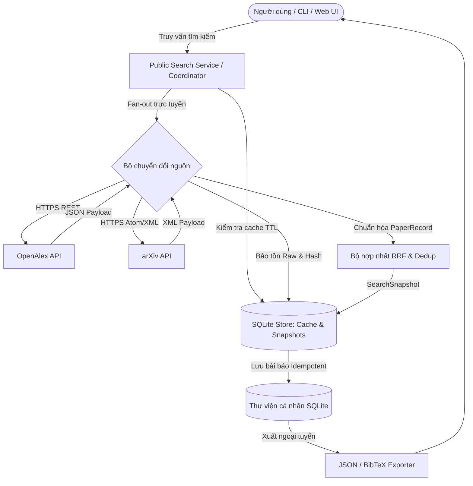

# Hướng dẫn Sử dụng — ScholarGraph Public Paper Search (Extension MVP)

Tài liệu này cung cấp hướng dẫn toàn diện về kiến trúc, cách thiết lập môi trường, vận hành công cụ dòng lệnh (CLI), khởi chạy dịch vụ Web API & giao diện người dùng (UI), cũng như cơ chế xử lý lỗi và xuất dữ liệu của tiện ích mở rộng Tìm kiếm Bài báo Công cộng (**Public Paper Search Extension** — Mã card [`EXT-08`](file:///D:/Web_mining_20261/scholargraph/docs/PUBLIC_PAPER_SEARCH_TASKS.md#L217-L223)) thuộc dự án ScholarGraph VN.

---

## 1. Tổng quan Kiến trúc & Phạm vi Dữ liệu

Tiện ích Public Paper Search được thiết kế để mở rộng khả năng tiếp cận tài liệu khoa học trực tuyến mà vẫn bảo toàn tính toàn vẹn và độc lập tuyệt đối với kho dữ liệu ngoại tuyến cốt lõi (Core SciFact Benchmark & Citation Graph).



### Các nguyên tắc vận hành cốt lõi:
1. **Truy cập API Công cộng Chính thức:** Hệ thống chỉ giao tiếp với các cổng API công khai được tài liệu hóa chính thức của [OpenAlex API](https://api.openalex.org/works) và [arXiv API](https://export.arxiv.org/api/query).
2. **Không Web Crawler / Không Tải Lậu PDF:** Tuyệt đối không sử dụng bộ cào dữ liệu (crawler) trên website của nhà xuất bản, không tự động bẻ khóa hay tải tệp PDF về máy chủ. Mọi liên kết bài báo và tệp PDF đều là liên kết trực tiếp (landing URLs / direct open-access URLs) do nguồn cung cấp.
3. **Luồng dữ liệu khép kín & Minh bạch nguồn gốc (Full Provenance):**
   - **Tìm kiếm trực tuyến (Online Search):** Thực hiện song song (fan-out) tới các nguồn hợp lệ.
   - **Lưu trữ Snapshot & Raw:** Toàn bộ phản hồi thô (raw bytes) và giá trị băm SHA-256 được lưu trữ bất biến vào cơ sở dữ liệu SQLite.
   - **Hợp nhất dữ liệu (RRF Fusion):** Thuật toán Reciprocal Rank Fusion kết hợp thứ hạng từ các nguồn, loại trùng dựa trên định danh chuẩn (DOI chuẩn hóa hoặc định danh nguồn).
   - **Lưu vào Thư viện Cá nhân (Library Save):** Cho phép người dùng đánh dấu và lưu bài báo từ một snapshot hợp lệ với cơ chế lũy kế (idempotent), không gây trùng lặp.
   - **Xuất dữ liệu ngoại tuyến (Offline Export):** Hỗ trợ kết xuất thư viện ra định dạng chuẩn `JSON` hoặc `BibTeX` hoàn toàn cục bộ, không phụ thuộc vào kết nối mạng bên ngoài.
4. **Độc lập với Hệ thống Offline Core:** Toàn bộ mã nguồn, cấu hình, dữ liệu bộ nhớ đệm và thư viện của tiện ích này nằm tách biệt trong `src/scholargraph/public_search/`, `data/public_search/` và `configs/public_search.json`; không sửa đổi hay gây nhiễu lên 33 tệp đóng băng cốt lõi của ScholarGraph.

---

## 2. Yêu cầu Hệ thống & Thiết lập Môi trường

### 2.1. Yêu cầu Tiền đề
- **Hệ điều hành:** Hỗ trợ Windows 10/11, Linux (Ubuntu 22.04+), macOS.
- **Phiên bản Python:** Yêu cầu `Python >= 3.10` (theo khai báo chuẩn tại [`pyproject.toml`](file:///D:/Web_mining_20261/scholargraph/pyproject.toml#L10)). Môi trường đã được kiểm toán thực tế trong toàn bộ các phiên nghiệm thu là **Python 3.12.14** (Windows x64).

### 2.2. Biến Môi trường & Môi trường Ảo (Virtualenv)
Bắt buộc phải thiết lập biến môi trường `PYTHONPATH` trỏ tới thư mục `src` của dự án để Python nhận diện gói nội bộ `scholargraph`.

**Trên Windows (PowerShell):**
```powershell
# Kích hoạt môi trường ảo của dự án
.\.venv\Scripts\Activate.ps1

# Thiết lập PYTHONPATH cho phiên làm việc hiện tại
$env:PYTHONPATH = "src"
```

**Trên Linux / macOS (Bash/Zsh):**
```bash
source .venv/bin/activate
export PYTHONPATH="src"
```

> [!NOTE]
> **Ghi nhận trạng thái phụ thuộc:** Danh mục thư viện được khóa bất biến tại tệp [`requirements.lock`](file:///D:/Web_mining_20261/scholargraph/requirements.lock) (SHA-256: `b68fcdc47fdbc67460e8384087e0fde8d62fc8fe820a6cf9b220283e0298d57d`). Trong đợt kiểm toán này, quy trình cài đặt mới từ mạng (`fresh pip install`) được phân loại là `NOT_RUN` nhằm bảo đảm tính ổn định tuyệt đối của môi trường kiểm thử cục bộ sẵn có.

---

## 3. Cấu hình & Chính sách Nguồn Dữ liệu

Tệp cấu hình mặc định đặt tại [`configs/public_search.json`](file:///D:/Web_mining_20261/scholargraph/configs/public_search.json):

```json
{
  "schema_version": 1,
  "contract_version": "1.0.0",
  "config_version": "1.0.0-audited",
  "data_root": "data/public_search/sol",
  "cache_ttl_seconds": 86400,
  "deadline_seconds": 30.0,
  "sources": {
    "openalex": {
      "endpoint": "https://api.openalex.org/works",
      "source_policy_verified": true,
      "policy_evidence_sha256": "a37778605f63821b820edc27b20ad5c859b05761d450980650336a4b8b727923",
      "auth_mode": "anonymous",
      "key_env": null,
      "interval_seconds": 1.0,
      "timeout_seconds": 30.0,
      "max_retries": 2,
      "backoff_seconds": 1.0,
      "max_body_bytes": 10000000,
      "content_types": ["application/json"]
    },
    "arxiv": {
      "endpoint": "https://export.arxiv.org/api/query",
      "source_policy_verified": true,
      "policy_evidence_sha256": "a37778605f63821b820edc27b20ad5c859b05761d450980650336a4b8b727923",
      "auth_mode": "anonymous",
      "key_env": null,
      "interval_seconds": 3.0,
      "timeout_seconds": 30.0,
      "max_retries": 2,
      "backoff_seconds": 1.0,
      "max_body_bytes": 10000000,
      "content_types": ["application/atom+xml", "application/xml", "text/xml"]
    }
  }
}
```

### Các thông số quan trọng:
- `data_root`: Thư mục lưu trữ SQLite DB, file raw payload và markers (mặc định: `data/public_search/sol`).
- `cache_ttl_seconds`: Thời gian sống của cache truy vấn, đặt là `86400` giây (24 giờ). Các truy vấn trùng lặp trong thời gian này sẽ đọc trực tiếp từ cache nội bộ thay vì gửi request qua internet.
- `deadline_seconds`: Hạn mức thời gian tối đa `30.0` giây cho toàn bộ phiên tìm kiếm.
- **Xác thực Ẩn danh (`auth_mode: "anonymous"`, `key_env: null`):**
  > [!IMPORTANT]
  > Cả OpenAlex và arXiv đều vận hành hoàn toàn ở chế độ công cộng ẩn danh. Hệ thống **tuyệt đối không yêu cầu và không hỗ trợ** biến môi trường API key giả lập.
- **Bằng chứng Chính sách Nguồn (`policy_evidence_sha256`):** Giá trị `a37778605f...` đại diện cho bằng chứng kiểm toán chính sách đã được phê duyệt trong card EXT-01B. Điều này không đồng nghĩa với việc chính sách được kiểm tra kết nối lại mỗi ngày, mà là cấu hình đã khóa theo hợp đồng nghiệm thu.

---

## 4. Khởi tạo Lưu trữ (Bắt buộc chạy trước)

Theo nguyên tắc **Chống lỗi ngầm (Anti-Silent-Bypass)**, hệ thống không tự ý âm thầm tạo mới database hay thư mục khi thiếu tài nguyên. Do đó, người dùng **bắt buộc** phải thực thi lệnh `init-storage` một lần trước khi chạy tìm kiếm qua CLI hoặc khởi động máy chủ Web API:

```powershell
$env:PYTHONPATH = "src"
python scripts/search_public.py --project-root . --config configs/public_search.json init-storage
```

**Đầu ra chuẩn khi thành công (stdout):**
```json
{"status": "INITIALIZED", "contract_version": "1.0.0"}
```

Lệnh này sẽ tạo cấu trúc thư mục tại `data_root`, tệp cơ sở dữ liệu `library.sqlite3` với đầy đủ schema version 1, và tệp đánh dấu `storage_version.json`. Nếu bỏ qua bước này, các lệnh `search` hay khởi động FastAPI sẽ dừng ngay lập tức với mã lỗi `StoreError` (HTTP 500 / CLI exit code 1: `public search store unavailable`).

---

## 5. Hướng dẫn Sử dụng Công cụ Dòng lệnh (CLI)

Công cụ dòng lệnh chính đặt tại [`scripts/search_public.py`](file:///D:/Web_mining_20261/scholargraph/scripts/search_public.py).

### 5.1. Quy tắc Cú pháp Chung
```text
python scripts/search_public.py [--project-root <đường_dẫn>] [--config <đường_dẫn>] <subcommand> [các_cờ_tùy_chọn]
```

> [!WARNING]
> Lưu ý thứ tự tham số của `argparse`: Các tùy chọn toàn cục `--project-root` và `--config` **phải đứng TRƯỚC** tên subcommand (`search`, `results`, `library`, `export`). Đặt sai vị trí sẽ dẫn đến lỗi thoát mã `1`.

---

### 5.2. Lệnh Tìm kiếm (`search`)

Thực hiện tìm kiếm trực tuyến từ OpenAlex và arXiv, tự động ghi nhận snapshot vào kho lưu trữ.

```powershell
# Tìm kiếm cơ bản với 2 nguồn mặc định
python scripts/search_public.py search --query "knowledge graph"

# Tìm kiếm với tham số tùy chỉnh (top_k=3, cap=3/nguồn, buộc làm mới không dùng cache)
python scripts/search_public.py search --query "graph neural network" --sources openalex,arxiv --top-k 3 --cap-per-source 3 --refresh

# Tìm kiếm có lọc theo năm xuất bản
python scripts/search_public.py search --query "information retrieval" --year-from 2020 --year-to 2024
```

**Bảng chi tiết các cờ lệnh `search`:**

| Tùy chọn | Kiểu dữ liệu | Giá trị mặc định | Mô tả |
| :--- | :--- | :--- | :--- |
| `--query` | Chuỗi | Bắt buộc (nếu không có `--request`) | Chuỗi truy vấn văn bản (độ dài 1..500 ký tự). |
| `--sources` | Danh sách | `openalex,arxiv` | Danh sách nguồn phân cách bằng dấu phẩy. |
| `--top-k` | Số nguyên | `20` | Số lượng bài báo tối đa sau khi hợp nhất RRF. |
| `--cap-per-source`| Số nguyên | `50` | Số bài báo tối đa lấy về từ mỗi nguồn API trước khi RRF. |
| `--year-from` | Số nguyên | `null` | Năm xuất bản bắt đầu (ví dụ: `2021`). |
| `--year-to` | Số nguyên | `null` | Năm xuất bản kết thúc (ví dụ: `2025`). |
| `--refresh` | Cờ bật | `false` | Nếu có, bỏ qua cache hiện có và buộc truy vấn lại từ API mạng. |
| `--request` | Tệp JSON | `null` | Đường dẫn tệp chứa payload `SearchRequest` chuẩn. |

**Quy tắc mã thoát CLI (Exit Codes):**
- **Thoát `0`:** Toàn bộ các nguồn yêu cầu đều thành công (`overall: "success"` hoặc `"empty"` và mảng `errors` rỗng).
- **Thoát `1`:** Có lỗi phát sinh hoặc **lỗi một phần** (`overall: "partial"` hoặc `"failed"`, ví dụ arXiv bị timeout nhưng OpenAlex thành công; hoặc tham số dòng lệnh không hợp lệ).

---

### 5.3. Lệnh Đọc Kết quả Snapshot (`results`)

Đọc lại toàn bộ nội dung của một snapshot tìm kiếm trước đó dựa trên ID snapshot (dạng `ps-...`):

```powershell
python scripts/search_public.py results ps-1039af03e9134d119997804398d8bade
```
- Thoát mã `0` nếu snapshot có trạng thái `success` hoặc `empty`.
- Thoát mã `1` nếu snapshot là `partial` hoặc `failed`.

---

### 5.4. Lệnh Xem Thư viện Cá nhân (`library`)

Liệt kê danh sách bài báo đã được người dùng lưu trữ trong cơ sở dữ liệu SQLite:

```powershell
python scripts/search_public.py library --offset 0 --limit 50
```

**Đầu ra mẫu:**
```json
{
  "contract_version": "1.0.0",
  "entries": [
    {
      "canonical_id": "doi:10.1145/3447548.3467450",
      "saved_at": "2026-10-01T06:50:22.123456Z",
      "record": {
        "title": "A Survey on Knowledge Graphs",
        "source": "openalex",
        "source_id": "W3160241234",
        "landing_url": "https://doi.org/10.1145/3447548.3467450",
        "citation_count": 1420
      }
    }
  ],
  "errors": []
}
```

---

### 5.5. Lệnh Xuất Dữ liệu Ngoại tuyến (`export`)

Xuất toàn bộ bài báo trong thư viện cá nhân ra chuẩn dữ liệu quốc tế để đưa vào các phần mềm quản lý trích dẫn (Zotero, Mendeley, Overleaf, LaTeX):

```powershell
# Xuất định dạng JSON chuẩn UTF-8
python scripts/search_public.py export --format json > my_library.json

# Xuất định dạng BibTeX chuẩn UTF-8
python scripts/search_public.py export --format bibtex > my_library.bib
```

- **JSON:** Chứa đầy đủ đối tượng `PaperRecord`, thông tin xuất xứ trường (`field_provenance`), trạng thái Open Access, và số lượt trích dẫn.
- **BibTeX:** Tự động tạo các mục `@article` hoặc `@misc` chuẩn xác. Các ký tự đặc biệt trong tiêu đề và tác giả như `&`, `%`, `$`, `#`, `_`, `{`, `}` đều được hệ thống tự động escape để tránh lỗi biên dịch LaTeX.

---

## 6. Khởi động Dịch vụ Web API & Giao diện Trực quan

Hệ thống tích hợp trực tiếp các tuyến đường phục vụ tìm kiếm vào ứng dụng FastAPI của ScholarGraph.

### 6.1. Lệnh Khởi động Máy chủ Production Cục bộ

```powershell
$env:PYTHONPATH = "src"
& .venv/Scripts/python.exe -m uvicorn scholargraph.api.app:app --host 127.0.0.1 --port 8000
```

> [!CAUTION]
> **QUY TẮC BẮT BUỘC: CHỈ CHẠY ĐƠN TIẾN TRÌNH (SINGLE WORKER)**
> Tuyệt đối **KHÔNG** sử dụng cờ `--workers > 1` (ví dụ `--workers 4`). Bộ quản lý giới hạn tần suất (`RateState`) được lưu trữ trong bộ nhớ nội bộ của tiến trình (process-local). Nếu chạy nhiều tiến trình worker, các tiến trình sẽ không thể phối hợp nhịp độ gọi API, dẫn đến nguy cơ bị chặn IP bởi chính sách của arXiv (tối đa 1 request / 3 giây) hoặc OpenAlex.

---

### 6.2. Các Điểm cuối API Công cộng (`/public`)

Khi máy chủ khởi động thành công, các endpoint sau sẽ sẵn sàng phục vụ:

| Phương thức | Đường dẫn Endpoint | Mục đích & Mô tả |
| :--- | :--- | :--- |
| `GET` | `/public` | **Kiểm tra trạng thái sẵn sàng (Readiness probe):** Trả về JSON `{"status": "ready", "contract_version": "1.0.0", "sources": ["openalex", "arxiv"]}`. |
| `GET` | `/public/ui` | **Giao diện Web tương tác:** Trang HTML trực quan cho phép tìm kiếm, xem chi tiết nguồn gốc, lưu bài báo và xuất dữ liệu. |
| `GET` / `POST` | `/public/search` | **API Tìm kiếm:** Tiếp nhận tham số truy vấn qua query params hoặc JSON body, trả về phong bì `SearchEnvelope`. |
| `GET` | `/public/results/{id}` | **API Chi tiết Snapshot:** Lấy thông tin chi tiết của một snapshot đã lưu. |
| `GET` | `/public/library` | **API Danh sách Thư viện:** Trả về danh sách bài báo đã lưu (`offset`, `limit`). |
| `POST` | `/public/library` | **API Lưu bài báo:** Lưu bài báo vào thư viện cá nhân với body: `{"snapshot_id": "...", "canonical_id": "..."}`. Thao tác mang tính idempotent (lưu nhiều lần cùng bài báo không gây lỗi). |
| `GET` | `/public/library/export` | **API Xuất Thư viện:** Nhận tham số `?format=json` hoặc `?format=bibtex`, trả về tệp nhị phân đính kèm tương ứng. |

### 6.3. Cổng Preview Demo Phục vụ Thử nghiệm
Trong các đợt kiểm thử giao diện độc lập, máy chủ preview gọn nhẹ có thể được khởi chạy tại cổng **`8011`** thông qua kịch bản:
```powershell
$env:PYTHONPATH = "src"
& .venv/Scripts/python.exe .tmp/ext06-095/serve_demo.py
```
(Sử dụng cấu hình riêng biệt tại `data/public_search/muse/pilot_ext06/config.json`).

---

## 7. Cơ chế Chống Chịu Lỗi, Bộ nhớ đệm & Xuất xứ Dữ liệu

### 7.1. Phân biệt Rõ ràng các Trạng thái Kết quả

Hệ thống phân định rạch ròi trạng thái của từng phản hồi tìm kiếm trong phong bì `SearchEnvelope`:
- **`live` (`cached: false`):** Dữ liệu vừa được truy vấn trực tiếp từ mạng internet qua API nguồn bên ngoài.
- **`cached_fresh` (`cached: true`):** Dữ liệu được đọc tức thì từ bộ nhớ đệm SQLite nội bộ do truy vấn trùng khớp hoàn toàn và còn trong hạn TTL (86,400 giây).
- **`stale` (`stale: true`):** Dữ liệu quá hạn TTL nhưng được phục vụ tạm thời khi kết nối mạng bên ngoài bị gián đoạn.
- **`partial` (`overall: "partial"`):** **Trạng thái thành công một phần.** Ví dụ: OpenAlex trả về kết quả hợp lệ nhưng arXiv bị quá hạn ngạch (HTTP 429) hoặc quá thời gian chờ (Timeout > 30s). Trong trường hợp này:
  - Các bài báo từ nguồn lành lặn vẫn được hiển thị đầy đủ đến người dùng.
  - Mã trạng thái HTTP trả về mã cảnh báo tương ứng (ví dụ HTTP 504 hoặc 429).
  - Giao diện người dùng hiển thị banner màu vàng cảnh báo nguồn bị gián đoạn cùng thông điệp lỗi rõ ràng.
- **`failed` (`overall: "failed"`):** Toàn bộ các nguồn được yêu cầu đều không phản hồi; mảng kết quả rỗng và mảng `errors` chứa chi tiết nguyên nhân.

---

### 7.2. Nguyên tắc Không Fallback Ngầm (Anti-Silent-Bypass)

1. **Hiển thị Rõ Dữ liệu Khuyết thiếu:** Nếu bài báo không có tóm tắt (`abstract = null`), không rõ tác giả, hoặc trạng thái Open Access không xác định (`oa_status = "unknown"`), hệ thống sẽ hiển thị minh bạch nhãn cảnh báo tương ứng trên giao diện thay vì âm thầm thay thế bằng chuỗi rỗng hay giá trị giả định.
2. **Số đếm Trích dẫn (`citation_count`):** Số đếm trích dẫn được lấy nguyên gốc từ OpenAlex để cung cấp thêm ngữ cảnh tra cứu. **Tuyệt đối không sử dụng số trích dẫn làm thước đo chất lượng, độ chính xác hay độ tin cậy khoa học của bài báo.**
3. **Truy vấn Tiếng Việt Nguyên văn (Verbatim Search):** Hệ thống gửi nguyên văn cụm từ tìm kiếm tiếng Việt (ví dụ `"xử lý ngôn ngữ tự nhiên"`) tới các API nguồn mà **không qua bộ dịch tự động ngầm**. Điều này đảm bảo tính trung thực với ý định của người dùng và giúp đánh giá chính xác độ bao phủ tài liệu tiếng Việt trên OpenAlex và arXiv.

---

## 8. Giới hạn Đã biết & Lộ trình Giai đoạn B (Phase B)

1. **Hạn mức Tần suất của arXiv (Rate Limiting):** API công cộng của arXiv áp dụng chính sách giới hạn nghiêm ngặt (tối thiểu 3.0s giãn cách giữa các truy vấn). Khi gửi nhiều yêu cầu liên tiếp trong thời gian ngắn, người dùng có thể gặp lỗi `quota` hoặc `timeout`. Hệ thống sẽ tự động chuyển sang chế độ `partial` để không làm gián đoạn trải nghiệm.
2. **Hợp nhất khi Thiếu DOI (F-03 Deferral):** Trong phiên bản MVP hiện tại, thuật toán loại trùng (deduplication) sử dụng định danh DOI chuẩn hóa. Đối với các tài liệu tiền ấn phẩm trên arXiv chưa được cấp DOI, việc liên kết bí danh (`arxiv_id` alias dedup) giữa OpenAlex và arXiv đã được ghi nhận và hoãn lại để triển khai trong Giai đoạn B ([`EXT-09`](file:///D:/Web_mining_20261/scholargraph/docs/PUBLIC_PAPER_SEARCH_TASKS.md#L224-L230) và [`EXT-10`](file:///D:/Web_mining_20261/scholargraph/docs/PUBLIC_PAPER_SEARCH_TASKS.md#L231-L237)).
3. **Phạm vi Đo lường Thời gian Dòng lệnh:** Thời gian thực thi CLI đo lường toàn trình (end-to-end), bao gồm cả thời gian khởi động trình thông dịch Python. Phép đo vi mô bóc tách chi phí nội hàm SQLite in-process chưa được thực hiện độc lập, do đó người dùng cần lưu ý khi đánh giá độ trễ của các lệnh gọi CLI đơn lẻ.
