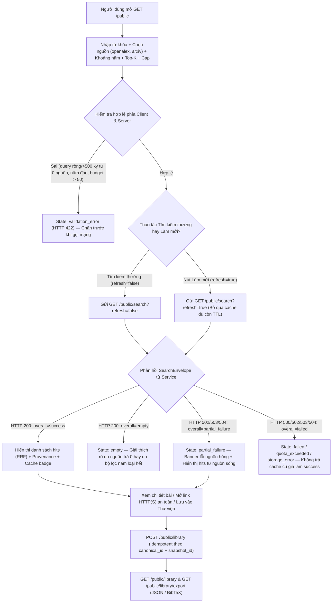

# Đặc tả Luồng Giao diện & Trạng thái Người dùng — Public Paper Search (`EXT-01C`)

- **Task ID:** `EXT-01C` (Wave `W0`)
- **Owner:** `GEMINI`
- **Reviewer:** `MUSE`
- **Dispatch ID:** `DISPATCH-20260930-W0-GEMINI`
- **Branch / Worktree:** `codex/public-search-gemini` (`D:/Web_mining_20261/scholargraph/.worktrees/public-gemini/scholargraph/`)
- **Trạng thái hợp đồng (Contract Status):** `PROPOSED_SOL_R2_RECONCILED` (Khớp 1:1 với proposed typed models tại `src/scholargraph/public_search/contracts.py` v1.0.0, commit head `cb64c59a`, contract code commit `774aeef0` của SOL; hợp đồng đang chờ review chung, chưa freeze W0). Toàn bộ tên trường, kiểu dữ liệu, các invariant, đẳng thức bộ đếm và validator executable (parse wire JSON bằng `model_validate_json`, kiểm tra ranh giới rò rỉ thật, kiểm thử phá hủy CLI subprocess, dynamic node traversal) đã được hoàn thiện tại vòng R2.

---

## 1. Nguyên tắc kiến trúc giao diện & Tách biệt ngữ cảnh (Context Isolation)

1. **Tách biệt hoàn toàn với Search Offline (SciFact Snapshot):**
   - Giao diện hiện có tại `GET /` (`ui/templates/search.html`, `/static/app.js`) phục vụ tập dữ liệu đóng băng nghiên cứu (`SciFact` / corpus nội bộ với BM25, Dense `bge-base`, Hybrid RRF).
   - Giao diện mở rộng đặt tại `GET /public` (`ui/templates/public_search.html`, `/static/public_search.js`, `/static/public_search.css`), mang tiêu đề rõ ràng: **“ScholarGraph VN — Tìm kiếm bài báo từ nguồn công khai (OpenAlex & arXiv)”**.
   - Trên `ui/templates/search.html`, chỉ bổ sung **một liên kết điều hướng tường minh** sang `/public` (và chiều ngược lại từ `/public` về `/`), không trộn kết quả online vào bảng kết quả offline.
2. **Độc lập khởi tạo (Zero Offline Dependency):**
   - Mở trang `GET /public`, xem thư viện `GET /public/library` và xuất dữ liệu `GET /public/library/export` **không** khởi tạo `SearchService` offline, không nạp model embedding, không đọc index SciFact hay các tệp nhãn/qrels (`SG-030`/`SG-033`).
   - Ngay cả khi môi trường chưa build index offline, `/public` vẫn hoạt động bình thường.
3. **Không gọi tính năng Offline cho bản ghi Online:**
   - Các bản ghi từ OpenAlex/arXiv hiển thị trên `/public` **không** gọi `/paper/{doc_id}` hoặc `/recommend/{doc_id}` (đồ thị trích dẫn / bài liên quan offline) nếu chưa có ánh xạ định danh đã kiểm chứng trong corpus nội bộ.
4. **Chống lỗi ngầm (Anti-Silent-Bypass trên UI):**
   - Không dùng giá trị mặc định giả (`""`, `0`, `"Unknown"`, `"N/A"` không phân biệt nguyên nhân) để che giấu trường dữ liệu bị thiếu hoặc nguồn bị lỗi.
   - Khi HTTP trả mã lỗi `non-2xx` (ví dụ `502`, `503`, `504` trong trường hợp `partial_failure` hoặc `failed`), JavaScript **bắt buộc đọc JSON body** của phản hồi để hiển thị cả thông báo lỗi nguồn lẫn danh sách kết quả hợp lệ từ nguồn còn sống (nếu có), thay vì chỉ quăng ngoại lệ chung chung.

---

## 2. Cấu trúc màn hình & Luồng tương tác người dùng (User Flows)

### 2.1. Thanh tìm kiếm, Bộ lọc & Cảnh báo ngôn ngữ
- **Ô nhập từ khóa (`query` / `q`):**
  - Trim khoảng trắng hai đầu; bắt buộc dài `1..500` ký tự.
  - Giữ nguyên hoa/thường theo đúng văn bản người dùng nhập (không tự ý lowercase làm đổi nghĩa thuật ngữ/tên riêng).
  - **Thông báo giới hạn ngôn ngữ (English Indexing Notice):** Hiển thị cố định ngay dưới thanh tìm kiếm:
    > *“Lưu ý ngôn ngữ: OpenAlex và arXiv chủ yếu lập chỉ mục tiêu đề/tóm tắt bằng tiếng Anh. Trong phạm vi MVP, truy vấn được gửi nguyên văn theo từ khóa bạn nhập (chưa tự động dịch Việt–Anh).”*
- **Bộ chọn nguồn (`sources`):**
  - Hai hộp kiểm (checkbox): `OpenAlex` (`openalex`) và `arXiv` (`arxiv`), mặc định chọn cả hai.
  - Nếu người dùng bỏ chọn cả hai nguồn: vô hiệu hóa nút gửi và hiển thị lỗi tại chỗ *“Vui lòng chọn ít nhất một nguồn tìm kiếm (OpenAlex hoặc arXiv).”* (Nếu gọi thẳng API không có nguồn: trả HTTP `422`).
- **Bộ lọc khoảng năm (`year_from`, `year_to`):**
  - Tùy chọn, số nguyên trong miền hợp lệ của schema `1800..2100`, thỏa mãn `year_from <= year_to`.
  - Nếu nhập sai kiểu hoặc `year_from > year_to`: báo lỗi cụ thể *“Khoảng năm không hợp lệ: Năm bắt đầu phải nhỏ hơn hoặc bằng năm kết thúc.”* (HTTP `422`).
  - **Quy tắc lọc năm với metadata khuyết:** Ghi chú rõ dưới bộ lọc: *“Bài báo không có năm xuất bản (`publication_year = null`) sẽ không khớp khi bạn bật bộ lọc năm và được thống kê riêng tại bộ đếm `excluded_by_year`.”*
- **Giới hạn số lượng (`top_k`) & Ngân sách nguồn (`cap_per_source`):**
  - Số nguyên từ `1` đến `50` (mặc định `top_k=20`, `cap_per_source=50`; ngân sách MVP tối đa `50` ứng viên/nguồn/request).
- **Hai nút hành động tách biệt:**
  1. **`Tìm kiếm` (`refresh=false`):** Cho phép đọc từ snapshot cache nếu còn hạn TTL (`cached=true`, `stale=false`).
  2. **`Làm mới từ nguồn` (`refresh=true`):** Bỏ qua cache hiện tại kể cả khi còn hạn TTL, gọi trực tiếp các nguồn đã chọn để tạo snapshot mới.
     - Chỉ khi toàn bộ request thành công (`overall` thuộc `{"success", "empty"}`), con trỏ cache mới được cập nhật nguyên tử (atomic).
     - Nếu `refresh=true` gặp lỗi (`partial_failure` hoặc `failed`), giao diện **báo lỗi rõ ràng**, tuyệt đối không tự động lấy bản cache cũ trả về như một lần làm mới thành công (`cached` vẫn là `false`). Nếu trước đó đã có snapshot lưu trong cache, giao diện hiển thị nút phụ **“Xem lại snapshot đã lưu trước đó (`snapshot_id`, thời điểm `fetched_at`)”** với nhãn `stale=true` tường minh.

### 2.2. Khu vực Trạng thái Nguồn, Bộ đếm & Giải thích Xếp hạng
- **Bảng trạng thái từng nguồn trong `SearchSnapshot.source_results` (danh sách `list[SourceResult]`):**
  - Hiển thị thẻ trạng thái độc lập cho `openalex` và `arxiv` với 4 giá trị enum chuẩn:
    - `success`: Truy vấn thành công và có ít nhất 1 bản ghi hợp lệ trong `records`. `error=null`.
    - `empty`: Nguồn phản hồi hợp lệ nhưng có `0` kết quả khớp (`records=[]`). `error=null`.
    - `failed`: Nguồn gặp lỗi (timeout, quota 429, lỗi 5xx, lỗi xác thực 401/403, hoặc bản ghi vi phạm schema bắt buộc). `error` bắt buộc khác `null` và `records=[]`.
    - `not_requested`: Người dùng không chọn nguồn này trong request. Không gọi mạng, `elapsed_seconds=null`.
- **Hiển thị bộ đếm minh bạch (Counter Reconciliation):**
  - Thể hiện chính xác theo mô hình `FusionCounts` của SOL:
    $$\text{raw} = \text{valid} + \text{invalid}$$
    $$\text{valid} = \text{eligible} + \text{excluded\_by\_year}$$
    $$\text{eligible} = \text{groups} + \text{duplicate\_excess}$$
    $$\text{returned} \le \text{groups} \quad (\text{và } \text{returned} = \text{len(hits)})$$
  - Trong snapshot hợp lệ: $\text{invalid} = 0$, và $\text{valid}$ bằng đúng tổng số records từ các nguồn đã hoàn tất đưa vào hợp nhất.
  - Nếu bản ghi từ nguồn thiếu trường bắt buộc (`title`, `source_id`, `landing_url`): toàn bộ nguồn đó chuyển sang `failed` với `error.kind = "schema"` kèm vị trí bản ghi lỗi (`record_index`), không âm thầm nuốt lỗi hay lọc bỏ ngầm.
- **Giải thích thuật toán xếp hạng RRF & Lượt trích dẫn:**
  - Hộp giải thích cố định phía trên danh sách kết quả:
    > *“Thứ tự kết quả được xếp hạng bằng Reciprocal Rank Fusion ($\text{RRF} = \sum \frac{1}{60 + \text{rank}}$, $\text{rank} \ge 1$) dựa trên thứ tự trả về của từng nguồn. Mỗi nguồn đóng góp tối đa một thứ hạng cho mỗi bài; trường hợp bằng điểm phân định xác định theo `canonical_id`.”*
  - Trường `citation_count` (khi có từ OpenAlex) chỉ hiển thị như thông tin tham khảo (*“Số lượt trích dẫn ghi nhận bởi OpenAlex: N — chỉ mang tính tham khảo metadata, không phải điểm chất lượng hay độ liên quan”*). Với bài chỉ có từ arXiv (`citation_count = null`), hiển thị *“Lượt trích dẫn: không có dữ liệu từ arXiv”*.

### 2.3. Thẻ Kết quả (Result Card), Gộp trùng & Chi tiết Bài báo (Detail View)
Mỗi kết quả trong `snapshot.fusion.hits` (`RankedHit`) hiển thị:
1. **Tiêu đề (`title`):** Lấy từ `display.title`. Bắt buộc không rỗng; render bằng `textContent` để chống XSS tuyệt đối.
2. **Định danh & Nguồn tìm thấy (`canonical_id`, `source_records`, `source_ranks`):**
   - Hiển thị huy hiệu nguồn dựa trên `source_ranks`: `[OpenAlex]`, `[arXiv]`, hoặc `[OpenAlex + arXiv]`.
   - Hiển thị `doi` (chuẩn hóa dạng `10.<digits>/<suffix>`) và `arxiv_id`.
   - Nếu hai bài có tiêu đề tương tự nhưng không có DOI/arXiv ID chung do nguồn cung cấp tường minh: **giữ thành 2 thẻ riêng biệt** với `canonical_id` độc lập; không suy đoán gộp trùng sai lệch.
3. **Tác giả (`authors`, `authors_availability`):**
   - Phân biệt 2 trạng thái chuẩn từ typed contract:
     - `authors_availability = "known"`: Hiển thị danh sách tên tác giả (nếu `authors = []`, hiển thị *“Nguồn xác nhận danh sách tác giả rỗng”*).
     - `authors_availability = "missing"`: Hiển thị huy hiệu cảnh báo *“Chưa rõ tác giả (metadata thiếu từ nguồn)”* — không suy diễn là bài khuyết danh.
4. **Năm xuất bản (`publication_year`), Nơi công bố (`venue`), Tóm tắt (`abstract`):**
   - Mọi trường tùy chọn có giá trị `null` được liệt kê chính xác trong `missing_fields`:
     - `publication_year = null` $\rightarrow$ *“Năm xuất bản: không có dữ liệu”*
     - `venue = null` $\rightarrow$ *“Nơi công bố / Chuyên mục: không có dữ liệu”*
     - `abstract = null` $\rightarrow$ *“Tóm tắt: nguồn không cung cấp bản tóm tắt (Title-only record hợp lệ)”*
5. **Provenance theo trường & Xung đột metadata (`field_provenance`, `conflicts`):**
   - Trong khung Chi tiết (`Detail Panel`), hiển thị rõ mỗi trường hiện diện trỏ tới `FieldEvidence` (chứa `source`, `source_id`, `raw_sha256`, `raw_field`).
   - Nếu có xung đột giữa các nguồn (ví dụ năm xuất bản giữa OpenAlex và arXiv): trường `conflicts` lưu danh sách `FieldEvidence` bất đồng để người dùng đối chiếu.
6. **Quyền truy cập Mở (Open Access) & Liên kết ngoài an toàn:**
   - Tách biệt rõ 2 khái niệm:
     - **`landing_url` (Trang thông tin bài báo):** Bắt buộc có và hợp lệ (`http://` hoặc `https://`). Nút nhãn: *“Mở trang bài báo tại nguồn”*.
     - **`open_access_status` & `pdf_url` (Quyền đọc toàn văn / PDF):**
       - Khi `open_access_status == "open"` và có `pdf_url` hợp lệ (`http/https`): hiển thị nút *“Mở PDF công khai”*.
       - Khi `open_access_status` là `"closed"`, `"unknown"` hoặc `pdf_url = null`: **ẩn hoàn toàn nút mở PDF**, hiển thị nhãn *“Toàn văn / PDF: Chưa xác nhận quyền truy cập mở (`oa_unknown`) — chỉ có liên kết trang thông tin bài báo”*.
   - **Kiểm tra an toàn URL (URL Sanitization):** Chỉ cho phép tạo thẻ `<a href="...">` khi URL parse thành công với scheme `http:` hoặc `https:` và không chứa thông tin đăng nhập (`username`/`password`). Mọi giá trị `javascript:`, `data:`, `file:`, hoặc URL có ký tự điều khiển đều bị chặn render thành liên kết và hiển thị cảnh báo *“Liên kết không an toàn/bị từ chối”*.

### 2.4. Phân trang trên Snapshot (`GET /public/results/{snapshot_id}`)
- Mọi thao tác chuyển trang kết quả đọc trực tiếp từ `snapshot_id` đã chốt của lần tìm kiếm đó.
- Thanh phân trang hiển thị rõ: *“Trang X / Y trên Snapshot `#snapshot_id` (chốt lúc `fetched_at`)"*.

### 2.5. Thư viện cá nhân & Xuất dữ liệu (`Library & Export`)
- **Lưu bài báo (`POST /public/library`):**
  - Gửi `{ "snapshot_id": "...", "canonical_id": "..." }`.
  - Trả về bản ghi `LibraryEntry` (`canonical_id`, `snapshot_id`, `saved_at`, `hit`, `incomplete_sources`).
  - Nếu lưu từ snapshot có `overall == "partial_failure"`, cờ `incomplete_sources = true` được ghi nhận tường minh.
  - **Thông báo rõ giới hạn lưu trữ:** *“Lưu vào thư viện chỉ lưu siêu dữ liệu (metadata) và dấu vết nguồn (provenance) trong SQLite cục bộ để tra cứu/trích dẫn offline; không tải hoặc lưu trữ tệp PDF toàn văn.”*
- **Xem thư viện (`GET /public/library`) & Xuất trích dẫn (`GET /public/library/export`):**
  - Hoạt động độc lập không phụ thuộc mạng.
  - Hỗ trợ xuất 2 định dạng: `JSON` (`?format=json`) và `BibTeX` (`?format=bibtex`).

---

## 3. Danh mục 9 Trạng thái Giao diện Bắt buộc (Mandatory UI States)

| Mã trạng thái | Điều kiện kích hoạt | Thông điệp hiển thị trên UI (Wording chuẩn) | Hành động / Nút cho phép |
|---|---|---|---|
| `loading` | Đang chờ phản hồi từ `/public/search` hoặc `/public/results/{snapshot_id}` | *“Đang truy vấn nguồn công khai (`openalex`, `arxiv`)… Vui lòng chờ (tối đa theo ngân sách deadline 30s).”* | Khóa nút `Tìm kiếm` và `Làm mới` của form hiện tại; tự động hủy request cũ qua `AbortController` nếu gửi truy vấn mới. |
| `empty` | `overall = "empty"` (HTTP `200`): Tất cả nguồn được chọn đều hoàn tất (`success` hoặc `empty`) nhưng `hits = []` | - Nếu nguồn trả về 0 bài: *“Không tìm thấy bài báo nào khớp với từ khóa trên các nguồn đã chọn.”* - Nếu có bài nhưng bị loại bởi bộ lọc năm (`excluded_by_year > 0`): *“Các nguồn có bài hợp lệ nhưng tất cả đều nằm ngoài khoảng năm đã lọc (`excluded_by_year` bài bị loại).”* | Gợi ý nới rộng khoảng năm, bật thêm nguồn tìm kiếm, hoặc thử từ khóa tiếng Anh tương đương. |
| `missing_fields` | Bản ghi hợp lệ nhưng có trường tùy chọn bằng `null` (`abstract`, `publication_year`, `doi`, `venue`, `pdf_url`, `citation_count`) hoặc `authors_availability == "missing"` | Hiển thị huy hiệu xám tương ứng cho từng trường trong `missing_fields`: *“Tóm tắt: không có”*, *“Năm: không có”*, *“DOI: không có”*, *“Tác giả: không rõ từ nguồn”*. Tuyệt đối không tự điền chuỗi giả hay số `0`. | Vẫn cho phép xem chi tiết, mở `landing_url` hợp lệ và lưu metadata vào thư viện. |
| `partial_failure` | `overall = "partial_failure"` (HTTP `502`/`503`/`504`): Ít nhất một nguồn được chọn `failed` và ít nhất một nguồn hoàn tất (`success` hoặc `empty`) | Banner cảnh báo màu hổ phách/đỏ ở đầu trang: *“Cảnh báo kết quả không đầy đủ (`partial_failure`): Nguồn `<source>` gặp lỗi (`<kind>`: `<message>`). Danh sách dưới đây chỉ phản ánh dữ liệu từ nguồn còn lại.”* | Đọc body JSON của phản hồi `non-2xx` để hiển thị các bài hợp lệ từ nguồn sống (nếu có); cho phép lưu bài hợp lệ kèm cờ `incomplete_sources=true`; hiển thị nút `Thử lại`. |
| `quota_exceeded` | Nguồn trả về lỗi giới hạn lượt truy cập (`error.kind == "quota"` / HTTP `503`) hoặc `retry_after_seconds` vượt quá ngân sách `deadline` | Banner cảnh báo: *“Nguồn `<source>` đã chạm giới hạn lượt truy cập (Quota / Rate Limit). Thời gian chờ khuyến nghị (`retry_after_seconds`): `<N>` giây.”* | Không tự động gửi lặp liên tục; cho phép tra cứu Thư viện cá nhân offline. |
| `cached_fresh` | Kết quả trả về từ SQLite cache còn trong thời hạn TTL (`cached = true`, `stale = false`) | Huy hiệu màu xanh lá: *“Dữ liệu từ bộ nhớ đệm còn hạn (`cached_fresh`) — Thu thập lúc: `<fetched_at>`, hết hạn lúc: `<expires_at>`, Snapshot: `<snapshot_id>`.”* | Hiển thị đầy đủ kết quả; cung cấp nút **`Làm mới từ nguồn` (`refresh=true`)** nếu muốn lấy dữ liệu mới nhất. |
| `cached_stale` | Người dùng chủ động mở một snapshot cũ đã quá hạn TTL (`cached = true`, `stale = true`), hoặc xem lại snapshot cũ sau khi thao tác `refresh=true` báo lỗi | Banner thông báo màu vàng đậm: *“Bạn đang xem bản lưu Snapshot cũ đã quá hạn TTL (`cached_stale` — thu thập lúc `<fetched_at>`). Đây là dữ liệu lịch sử do bạn chọn mở, không phải kết quả làm mới trực tiếp.”* | Cho phép đọc chi tiết và lưu bài từ snapshot lịch sử này; có nút `Thử làm mới lại từ nguồn`. |
| `oa_unknown` | `open_access_status` là `"unknown"` hoặc `"closed"`, hoặc `pdf_url = null` / không hợp lệ | Huy hiệu trên thẻ bài báo: *“Toàn văn / PDF: Chưa xác nhận Open Access (`oa_unknown`) — Liên kết trang bài báo không đồng nghĩa với việc có tệp PDF đọc miễn phí.”* | Chỉ hiển thị nút mở `landing_url` (nếu là `http/https` hợp lệ); **không** hiển thị nút tải/mở PDF. |
| `save_idempotent` | Người dùng bấm `Lưu vào thư viện` lần thứ hai trở đi cho cùng một `canonical_id` đã có trong SQLite Library | Đổi trạng thái nút trên thẻ bài báo thành: *“Đã có trong thư viện (`save_idempotent`: không tạo bản sao, giữ nguyên provenance)”* kèm thời điểm lưu ban đầu (`saved_at`). | Cho phép mở tab `Thư viện cá nhân` hoặc bấm `Xuất JSON` / `Xuất BibTeX`. |

---

## 4. Bảng Chân trị Trạng thái Tổng thể (Overall Status Truth Table) & Mã HTTP/CLI

Theo đúng hàm `overall_status` tại `src/scholargraph/public_search/contracts.py`:

| Ca kiểm thử (Case ID) | Nguồn được chọn | Trạng thái Nguồn 1 (`openalex`) | Trạng thái Nguồn 2 (`arxiv`) | Số `hits` sau filter/fusion | `overall` | HTTP Status | CLI Exit Code | Hành vi UI bắt buộc |
|---|---|---|---|---:|---|---:|---:|---|
| `TT-01` (`all_empty`) | `openalex`, `arxiv` | `empty` (0 raw) | `empty` (0 raw) | `0` | `empty` | `200` | `0` | Render state `empty`: cả 2 nguồn phản hồi bình thường nhưng không có bài khớp. |
| `TT-02` (`success_plus_empty_with_hit`) | `openalex`, `arxiv` | `success` ($\ge 1$ hit) | `empty` (0 raw) | $\ge 1$ | `success` | `200` | `0` | Render danh sách `hits`; bảng trạng thái nguồn ghi rõ `openalex: success`, `arxiv: empty`. |
| `TT-03` (`success_filtered_to_zero`) | `openalex`, `arxiv` | `empty` | `empty` | `0` | `empty` | `200` | `0` | Render state `empty` giải thích rõ không có bài trong khoảng năm lọc. |
| `TT-04` (`empty_plus_failed_no_hit`) | `openalex`, `arxiv` | `empty` (0 hit) | `failed` (timeout/quota/502) | `0` | `partial_failure` | `502`/`503`/`504` | `1` | **Không** được hiển thị như `empty` bình thường! Phải hiện banner lỗi `partial_failure` chỉ rõ nguồn bị lỗi và nguồn trả rỗng. |
| `TT-05` (`success_plus_failed_with_hit`) | `openalex`, `arxiv` | `success` ($\ge 1$ hit) | `failed` (timeout/quota/502) | $\ge 1$ | `partial_failure` | `502`/`503`/`504` | `1` | Đọc body JSON của HTTP `non-2xx`; hiện banner cảnh báo `partial_failure` cho nguồn lỗi và vẫn hiển thị danh sách `hits` từ nguồn sống. |
| `TT-06` (`all_failed`) | `openalex`, `arxiv` | `failed` | `failed` | `0` | `failed` | `502`/`503`/`504` | `1` | Hiện banner lỗi toàn phần (`failed`) chi tiết cho từng nguồn; không tự động trả cache cũ giả làm thành công. |
| `TT-07` (`no_source_selected`) | `[]` (rỗng) | `not_requested` | `not_requested` | `0` | *(invalid request)* | `422` | `1` | Chặn ngay trên form; nếu gửi qua API `SearchRequest` quăng `ValidationError` (HTTP `422`) trước khi gọi mạng. |

### Quy tắc ưu tiên mã HTTP khi có nhiều lỗi (`error_http_status`)
Thứ tự ưu tiên theo `contracts.py`:
1. **`request` $\rightarrow$ `422`** (Validation error trước mạng).
2. **`storage` $\rightarrow$ `500`** (SQLite lỗi/chưa khởi tạo).
3. **`config` $\rightarrow$ `500`** (Cấu hình không hợp lệ).
4. **`quota` $\rightarrow$ `503`** (Rate limited / Quota vượt deadline).
5. **`timeout` $\rightarrow$ `504`** (Quá thời gian chờ).
6. **`upstream` / `schema` / `auth` / `policy` $\rightarrow$ `502`** (Lỗi upstream, schema malformed, sai xác thực, vi phạm policy).

---

## 5. Bảo mật Giao diện, Chống Race Condition & Khả năng truy cập (Accessibility)

1. **Chống XSS & Script Injection:**
   - Toàn bộ dữ liệu từ nguồn ngoài (`title`, `abstract`, `authors`, `venue`, `doi`, `arxiv_id`, `error.message`) bắt buộc gắn qua `element.textContent` hoặc tạo DOM tường minh (`document.createElement`), tuyệt đối **không** nối chuỗi HTML thô gán vào `innerHTML`.
2. **Kiểm tra Scheme Liên kết (`safe_url`):**
   - Trước khi render bất kỳ liên kết nào (`landing_url`, `pdf_url`), URL phải pass quy tắc an toàn:
     - Scheme bắt buộc là `http` hoặc `https`.
     - Không chứa `username` hoặc `password`.
     - Không chứa ký tự điều khiển (ASCII $\le 32$) hoặc dấu gạch chéo ngược `\`.
   - Nếu vi phạm (ví dụ `javascript:alert(1)`, `data:text/html,...`): hiển thị nhãn cảnh báo và không render thành thẻ `<a>`.
3. **Hủy truy vấn cũ & Chống đè kết quả (Request Race / Cancellation):**
   - Mỗi lần bấm `Tìm kiếm` hoặc `Làm mới`, UI tăng biến đếm đơn điệu `currentRequestSeq++` và hủy `AbortController` của lượt gọi đang chạy.
   - Khi phản hồi trả về, chỉ cập nhật DOM nếu `responseSeq === currentRequestSeq`.
4. **Khả năng truy cập (Keyboard & Screen Reader Accessibility):**
   - Vùng thông báo trạng thái và banner lỗi gắn `role="status"` / `role="alert"` và `aria-live="polite"` (hoặc `"assertive"` cho lỗi `failed`/`partial_failure`).
   - Mọi nút thao tác (`Tìm kiếm`, `Làm mới từ nguồn`, `Xem chi tiết`, `Lưu vào thư viện`, `Xuất JSON`, `Xuất BibTeX`) đều điều hướng được bằng bàn phím (`Tab`, `Enter`, `Space`) và có `aria-busy="true"` khi đang xử lý.

---

## 6. Liên kết tới Bộ Ví dụ Request/Response Giả lập (`Synthetic Examples`)

Toàn bộ các ví dụ cụ thể cho từng trạng thái và từng dòng trong Bảng Chân trị (`TT-01`..`TT-07`, `cached_fresh`, `cached_stale`, `refresh_failure`, `save_idempotent`, `storage_error_500`, `xss_and_unsafe_url_sanitization`) được đóng gói tại:
- Tệp dữ liệu ví dụ: [`tests/fixtures/public_search/gemini/ux_examples.json`](../../tests/fixtures/public_search/gemini/ux_examples.json)
- Tệp sidecar xác thực nguồn gốc: [`tests/fixtures/public_search/gemini/ux_examples.sidecar.json`](../../tests/fixtures/public_search/gemini/ux_examples.sidecar.json)
- Script kiểm chứng tính hợp lệ: [`tests/fixtures/public_search/gemini/validate_fixtures.py`](../../tests/fixtures/public_search/gemini/validate_fixtures.py)

> **Cam kết trung thực dữ liệu (Data Integrity Notice):** Toàn bộ ví dụ trong `ux_examples.json` đều mang cờ `"synthetic": true`, `"not_live_evidence": true`, `"not_for_production_fallback": true`. Chúng chỉ phục vụ kiểm thử đơn vị/giao diện (unit/UI contract testing) và đặc tả UX trong `EXT-01C` / `EXT-05A`; tuyệt đối **không** được nạp làm dữ liệu fallback trong mã nguồn production và **không** được báo cáo làm bằng chứng truy vấn mạng thực tế (live pilot evidence).
