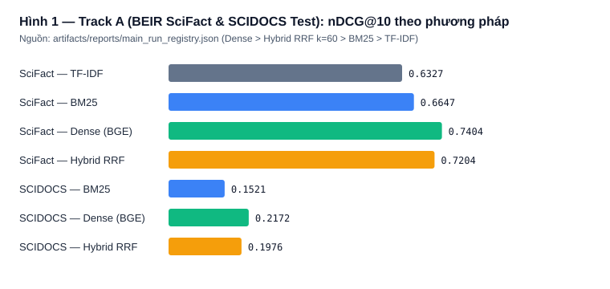
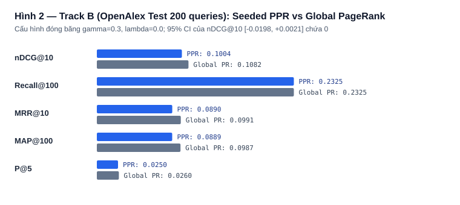
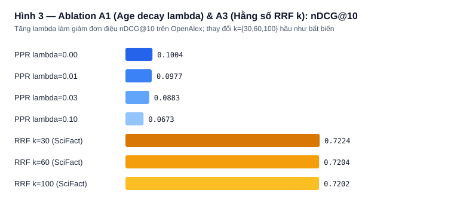
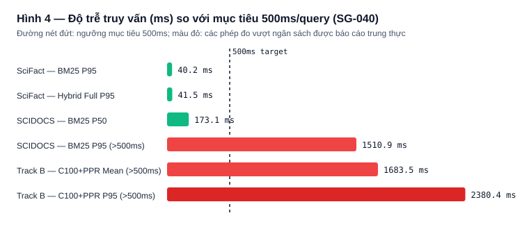

# Báo cáo Học thuật ScholarGraph VN: Thực nghiệm Truy hồi Văn bản Học thuật, Tái xếp hạng Đồ thị Trích dẫn và Tìm kiếm Xuyên ngữ Việt–Anh (SG-043)

> **Trạng thái tài liệu:** Bản thảo học thuật chuẩn bị bởi `GM-6` / `CX-4`, đối chiếu tự động 1:1 với [evidence_index.json](../artifacts/reports/evidence_index.json) và [frozen_main.json](../configs/frozen_main.json) (`sha256 = 34159fb133594633530c08390b259ea6efd7e024a384cb2c25092bf6e4797557`). Tài liệu này chờ hai thành viên con người hoàn tất các cổng `H-1` (`SG-030`), `H-2` (`SG-033`), `H-3` (`SG-034`, `SG-042`) và ký duyệt sở hữu cuối cùng.
>
> **Đối chiếu 2026-11-23:** các khoảng tin cậy, số truy vấn dev/test, công thức điều chỉnh tuổi, nhóm bậc Track B, số gói lỗi, pool Track C (v2, `ADR-023`) và nguồn gốc bộ truy vấn tiếng Việt đã được sửa cho khớp `statistics.json`, `robustness.json`, `split_audit.json`, `graph_audit.json`, `configs/protocol_v1.json`, `error_packets.json` và `data/annotations/v2/`. Các lời giải thích cơ chế (vì sao Hybrid thua Dense, vì sao PPR không vượt Global PageRank) vẫn là giả thuyết của bản thảo, chưa có phép đo riêng.

---

## Tóm tắt (Abstract)

Báo cáo này trình bày thiết kế, giao thức kiểm soát rò rỉ dữ liệu (leakage-free protocol) và kết quả thực nghiệm của **ScholarGraph VN** — một hệ thống tìm kiếm và gợi ý bài báo khoa học kết hợp truy hồi từ vựng (TF-IDF, BM25), truy hồi biểu diễn dày đặc (Dense Bi-Encoder `BAAI/bge-base-en-v1.5`), hợp nhất thứ hạng nghịch đảo (Reciprocal Rank Fusion — RRF), và tái xếp hạng trên đồ thị trích dẫn có hướng (Global PageRank, Personalized PageRank khởi tạo từ văn bản, cùng điều chỉnh độ tuổi bài báo). Thực nghiệm được niêm phong trước khi mở tập kiểm tra (`SG-027`) trên ba nhánh đánh giá tách biệt: **Track A** (truy hồi văn bản chuẩn trên BEIR SciFact 5.183 bài và SCIDOCS 25.657 bài), **Track B** (dự đoán trích dẫn theo lát cắt thời gian trên đồ thị OpenAlex 18.251 nút / 18.250 bài có văn bản, 200 truy vấn kiểm tra có năm xuất bản 2025), và **Track C** (truy vấn tiếng Việt xuyên ngữ sang kho bài báo tiếng Anh).

Kết quả thực nghiệm niêm phong chỉ ra cả **kết quả dương** lẫn ba **kết quả âm có ý nghĩa phương pháp luận**:
1. **Dense vượt trội BM25 trên cả hai bộ BEIR (`CLM-001`, `CLM-002`):** Trên SciFact test ($n=300$), Dense đạt `nDCG@10 = 0.7404` so với BM25 `0.6647` ($\Delta = +0.0757$, 95% paired bootstrap CI `[+0.0405, +0.1115]`). Trên SCIDOCS test ($n=1000$), Dense đạt `nDCG@10 = 0.2172` so với BM25 `0.1521` ($\Delta = +0.0652$, 95% CI `[+0.0549, +0.0753]`).
2. **Kết quả âm 1 — Hybrid RRF ($k=60$) thấp hơn Dense đơn lẻ (`CLM-003`):** Hợp nhất thứ hạng trọng số bằng nhau giữa BM25 và Dense đạt `nDCG@10 = 0.7204` trên SciFact ($\Delta = -0.0200$ so với Dense, 95% CI `[-0.0469, +0.0066]`) và `0.1976` trên SCIDOCS ($\Delta = -0.0197$, 95% CI `[-0.0273, -0.0122]`). Khi nhánh từ vựng yếu hơn đáng kể so với nhánh ngữ nghĩa, việc ép trọng số bằng nhau trong RRF kéo các tài liệu nhiễu khớp từ khóa lên top-10.
3. **Kết quả âm 2 — Seeded PPR không vượt Global PageRank trên tập ứng viên `C100` (`CLM-004`):** Trên OpenAlex `test200`, nhánh cấu hình đóng băng `ppr_age_best_g0.3_l0.0` ($\gamma=0.3, \lambda=0.0$) đạt `nDCG@10 = 0.1004` so với đối chứng `global_pagerank_control` `0.1082` ($\Delta = -0.0078$, 95% CI `[-0.0198, +0.0021]` chứa 0; cả hai có cùng `Recall@100 = 0.2325`).
4. **Kết quả âm 3 — Điều chỉnh tuổi bài báo ($\lambda > 0$) làm suy giảm đơn điệu độ liên quan (`CLM-005`):** Khi tăng $\lambda$ qua $\{0.0, 0.01, 0.03, 0.1\}$ tại $\gamma=0.3$, `nDCG@10` của PPR giảm từ `0.1004` xuống `0.0977`, `0.0883` và `0.0673`; hệ số suy giảm theo tuổi hạ điểm các bài cũ hơn bài truy vấn.
5. **Track C (Truy vấn tiếng Việt xuyên ngữ — `CLM-008`):** Đã hoàn tất 30 truy vấn (10 dev / 20 test), bộ nhớ đệm dịch máy (`Helsinki-NLP/opus-mt-vi-en`) và pool mù của bộ truy vấn v2 gồm 679 cặp (`SG-033`, `ADR-023`; bộ v1 662 cặp đã ngừng dùng để đánh giá), hiện ở trạng thái **chưa đo — chờ nhãn người SG-033**.

---

## 1. Câu hỏi Nghiên cứu (Research Questions) và Phạm vi

Dự án không tuyên bố phát minh thuật toán mới hay dẫn đầu bảng xếp hạng quốc tế, mà tập trung trả lời bốn câu hỏi thực nghiệm có kiểm chứng:

- **RQ1 (Text Retrieval — Track A):** Trên dữ liệu khoa học chuẩn (BEIR SciFact và SCIDOCS), biểu diễn dày đặc (`BAAI/bge-base-en-v1.5`) và hợp nhất RRF ($k=60$) cải thiện bao nhiêu so với truy hồi từ vựng cổ điển (TF-IDF, BM25), và khi nào hợp nhất lai (Hybrid) phản tác dụng?
- **RQ2 (Graph Reranking — Track B):** Khi tái xếp hạng tập ứng viên top-100 (`C100`) từ văn bản trên đồ thị trích dẫn OpenAlex đã cắt theo thời gian, Personalized PageRank khởi tạo theo truy vấn (Seeded PPR) có vượt đối chứng độ phổ biến toàn cục (Global PageRank) hay không?
- **RQ3 (Age Adjustment & Ablation):** Việc giảm điểm theo tuổi bài báo so với bài truy vấn ($\lambda > 0$) ảnh hưởng thế nào đến độ chính xác dự đoán trích dẫn và mức độ tiếp xúc theo độ tuổi bài báo (age exposure)?
- **RQ4 (Cross-Lingual Vietnamese Retrieval & System Cost — Track C & SG-040):** Chi phí độ trễ thực tế (warm/cold latency, RAM, dung lượng chỉ mục) của toàn bộ đường ống trên phần cứng cục bộ không GPU là bao nhiêu, và giao thức đánh giá mù hai người gán nhãn cho truy vấn tiếng Việt được thiết kế như thế nào để tránh thiên lệch?

---

## 2. Dữ liệu, Lát cắt Thời gian và Kiểm soát Rò rỉ (Data & Leakage Control)

Toàn bộ dữ liệu và lát cắt được kiểm toán tự động trong [DATA_CARD.md](../docs/DATA_CARD.md) và khóa mã băm SHA-256 trong [frozen_main.json](../configs/frozen_main.json):

| Bộ dữ liệu | Nhánh | Số tài liệu (Corpus) | Truy vấn Dev / Test | Quy tắc chống rò rỉ (Anti-Leakage Policy) |
|---|---|---:|---:|---|
| **BEIR SciFact** | Track A | 5.183 | 809 / 300 | Dev là tập `train` chính thức (809 truy vấn, 919 qrels), test là tập `test` chính thức (300 truy vấn, 339 qrels). Kiểm toán split (`SG-011`) phát hiện 2 truy vấn test trùng văn bản với 2 truy vấn dev (`1292`/`1291`, `870`/`871`); được ghi nhận, benchmark giữ nguyên. |
| **BEIR SCIDOCS** | Track A | 25.657 | không có / 1.000 | Chỉ có tập `test` chính thức (1.000 truy vấn, 29.928 qrels); dùng nguyên cấu hình đã cố định, không tune. 344 bài thiếu abstract được giữ nguyên và chỉ lập chỉ mục bằng `title` (không loại ngầm). |
| **OpenAlex Citation Graph** | Track B | 18.251 nút đồ thị (`18.250` bài có văn bản) | 100 / 200 | Cắt theo năm xuất bản: bài truy vấn dev thuộc năm 2024, test thuộc năm 2025. Với mỗi bài truy vấn, một phần tham chiếu (khoảng 20%, ít nhất 1) được giữ lại làm nhãn; tổng cộng 330 cạnh giữ lại bị ẩn khỏi đồ thị theo cả hai chiều (đồ thị còn 26.186 trong 26.516 cạnh, 0 cạnh sót). Ứng viên chỉ gồm các bài có năm không lớn hơn năm của bài truy vấn. Một bài khuyết hoàn toàn cả `title` lẫn `abstract` (`openalex:W126924136`) được ghi nhận tường minh theo `ADR-017`. |
| **VN Cross-Lingual Pilot** | Track C | 18.250 (`openalex_core_text`) | 10 / 20 | Bộ truy vấn v2 (`ADR-023`): 30 truy vấn tiếng Việt, mỗi truy vấn một `intent_family` riêng, do trợ lý AI soạn nháp từ thống kê chủ đề tổng hợp của corpus (không tham chiếu qrels hay tài liệu cụ thể) và được chủ dự án duyệt nguyên bản; pool top-10 từ ba phương pháp, ẩn tên phương pháp và điểm số (`data/annotations/v2/vn_pool.json`). |

Mỗi run Track A có một bản kiểm toán rò rỉ riêng trước khi chấm test (7 tệp `artifacts/final_test/leakage_A_<phương pháp>_<bộ dữ liệu>_test_<thời điểm>.json`, đều `PASS`): split đã khóa, đường xếp hạng không đọc qrels, không đổi cấu hình theo test. Với Track B, [graph_audit.json](../artifacts/reports/graph_audit.json) (`PASS`, 15 kiểm tra) ghi nhận 0 cạnh giữ lại còn sót trong đồ thị đã che ở cả hai chiều. Hai truy vấn SciFact trùng văn bản giữa dev và test nêu ở bảng trên là giới hạn đã biết của benchmark gốc.

---

## 3. Phương pháp và Kiến trúc Đường ống (Methodology)

### 3.1. Truy hồi Văn bản (Track A)
- **TF-IDF & BM25:** Cùng bộ tách từ chuẩn hóa chữ thường có giữ ký hiệu kỹ thuật (`k1 = 1.5, b = 0.75` cho BM25) trên trường ghép `title + " " + abstract`.
- **Dense Bi-Encoder:** Sử dụng mô hình đóng băng `BAAI/bge-base-en-v1.5` (`revision = a5beb1e3e68b9ab74eb54cfd186867f64f240e1a`, chiều vector $d = 768$, chuẩn hóa $L_2$, độ tương đồng tích vô hướng chính xác trên `ExactDenseIndex`).
- **Hybrid RRF:** Kết hợp danh sách top-100 của BM25 và Dense theo công thức Reciprocal Rank Fusion:
  $$\text{RRF}(d) = \frac{1}{k + r_{\text{BM25}}(d)} + \frac{1}{k + r_{\text{Dense}}(d)}, \quad k = 60$$
  Quy tắc phá hòa (tie-break) hoàn toàn tất định theo điểm giảm dần, sau đó theo `doc_id` tăng dần theo thứ tự từ điển. Ở tầng phục vụ API (`src/scholargraph/api/service.py`), nếu một nhánh trả về rỗng (ví dụ truy vấn tiếng Việt không trùng từ khóa tiếng Anh), hệ thống trả về nhánh còn lại kèm nhãn phương pháp có hậu tố trung thực (`+fallback-dense-only` hoặc `+fallback-lexical-only`), không bao giờ báo lỗi 500 hoặc che giấu việc suy biến.

### 3.2. Tái xếp hạng Đồ thị Trích dẫn và Điều chỉnh Tuổi (Track B)
Trên tập ứng viên `C100` (top-100 từ Hybrid RRF trên `openalex_core_text`, loại bỏ chính bài truy vấn `self-match`), điểm tái xếp hạng kết hợp chuẩn hóa min-max theo từng truy vấn, sau đó nhân với hệ số suy giảm theo tuổi:
$$F(q, d) = (1 - \gamma)\,\tilde{s}_{\text{text}}(q, d) + \gamma\,\tilde{s}_{\text{graph}}(q, d), \qquad S(q, d) = F(q, d)\cdot e^{-\lambda \max(0,\ \text{year}(q) - \text{year}(d))}$$
trong đó:
- $\tilde{s}_{\text{graph}}(q, d)$ là điểm **Seeded Personalized PageRank (PPR)** với hệ số cản $\alpha = 0.85$, vector dịch chuyển tức thời (teleportation) tỷ lệ với điểm RRF đã chuẩn hóa trên 20 hạt giống đầu của `C100`, hoặc **Global PageRank** (đối chứng không phụ thuộc truy vấn).
- Hệ số tuổi dùng năm xuất bản của bài truy vấn làm mốc (không dùng đồng hồ máy); $\lambda = 0$ là đối chứng không điều chỉnh tuổi. Bài thiếu năm bị loại khỏi Track B, không nội suy.
- Quá trình chọn siêu tham số trên tập `dev` (`SG-026`, lưới 20 cấu hình $\gamma \in \{0, 0.1, 0.2, 0.3\} \times \lambda \in \{0, 0.01, 0.03, 0.05, 0.1\}$) chọn cấu hình đạt `dev nDCG@10` cao nhất là $\gamma = 0.3, \lambda = 0.0$ (`0.1310` trên 100 truy vấn dev), khóa cứng trong `configs/frozen_main.json` trước khi mở tập `test`.

---

## 4. Kết quả Thực nghiệm Chính (Main Results — SG-028)

### 4.1. Track A — Truy hồi Văn bản trên BEIR SciFact & SCIDOCS

| Bộ dữ liệu | Phương pháp | Run ID | nDCG@10 | Recall@100 | MRR@10 | MAP@100 | P@5 |
|---|---|---|---:|---:|---:|---:|---:|
| `scifact` ($n=300$) | `tfidf` | `RUN-20260921-103129-tfidf-scifact-test` | `0.6327` | `0.8916` | `0.5937` | `0.5866` | `0.1620` |
| `scifact` ($n=300$) | `bm25` | `RUN-20260921-103103-bm25-scifact-test` | `0.6647` | `0.8892` | `0.6328` | `0.6260` | `0.1567` |
| `scifact` ($n=300$) | `dense` | `RUN-20260921-103405-dense-scifact-test` | **`0.7404`** | `0.9667` | **`0.7034`** | **`0.6978`** | **`0.1820`** |
| `scifact` ($n=300$) | `hybrid` | `RUN-20260921-103415-hybrid-scifact-test` | `0.7204` | **`0.9693`** | `0.6870` | `0.6810` | `0.1727` |
| `scidocs` ($n=1000$) | `bm25` | `RUN-20260921-103429-bm25-scidocs-test` | `0.1521` | `0.3495` | `0.2708` | `0.1040` | `0.1092` |
| `scidocs` ($n=1000$) | `dense` | `RUN-20260921-104021-dense-scidocs-test` | **`0.2172`** | **`0.4957`** | **`0.3586`** | **`0.1549`** | **`0.1588`** |
| `scidocs` ($n=1000$) | `hybrid` | `RUN-20260921-104036-hybrid-scidocs-test` | `0.1976` | `0.4675` | `0.3368` | `0.1421` | `0.1466` |

- **Khẳng định `CLM-001` & `CLM-002`:** Dense (`bge-base-en-v1.5`) vượt BM25 một cách nhất quán trên cả hai tập dữ liệu (`+0.0757 nDCG@10` trên SciFact và `+0.0652 nDCG@10` trên SCIDOCS), đều có khoảng tin cậy bootstrap 95% nằm hoàn toàn trên 0.
- **Khẳng định `CLM-003` (Kết quả âm 1 — Hybrid RRF thua Dense ở `nDCG@10`):** Dù Hybrid RRF nhích nhẹ `Recall@100` trên SciFact (`0.9693` so với `0.9667`), chỉ số chính `nDCG@10` của Hybrid lại thấp hơn Dense trên cả SciFact (`0.7204` vs `0.7404`) lẫn SCIDOCS (`0.1976` vs `0.2172`). Nguyên nhân cơ học: công thức RRF gán trọng số ngang nhau cho thứ hạng từ BM25 và Dense; khi BM25 đặt một bài báo chỉ khớp từ khóa bề mặt ở hạng 1–3 nhưng bài đó không liên quan ngữ nghĩa, điểm thưởng $\frac{1}{60+r}$ đủ lớn để đẩy bài đó vượt qua các bài liên quan thực sự ở hạng 4–10 của Dense.

### 4.2. Track B — Tái xếp hạng Đồ thị Trích dẫn trên OpenAlex (`test200`)

| Nhánh đánh giá (`n = 200` queries) | Cấu hình đóng băng | nDCG@10 | Recall@100 | MRR@10 | MAP@100 | P@5 |
|---|---|---:|---:|---:|---:|---:|
| `ppr_age_best_g0.3_l0.0` | $\gamma=0.3, \lambda=0.0$ (Seeded PPR) | `0.1004` | `0.2325` | `0.0890` | `0.0889` | `0.0250` |
| `global_pagerank_control` | $\gamma=0.3, \lambda=0.0$ (Global PageRank) | **`0.1082`** | `0.2325` | **`0.0991`** | **`0.0987`** | **`0.0260`** |

- **Khẳng định `CLM-004` (Kết quả âm 2 — PPR không vượt Global PageRank):** Trên 200 bài báo kiểm tra năm $\ge 2025$, nhánh chính `ppr_age_best_g0.3_l0.0` đạt `nDCG@10 = 0.1004`, thấp hơn nhẹ so với đối chứng `global_pagerank_control` (`0.1082`), với $\Delta = -0.0078$ và khoảng tin cậy paired bootstrap 95% `[-0.0198, +0.0021]` **chứa 0**. Cả hai nhánh đều bị giới hạn bởi trần ứng viên `C100` (`Recall@100 = 0.2325`). Trên đồ thị trích dẫn thưa, các hạt giống văn bản top-k chứa nhiễu khiến bước lan truyền PPR cục bộ phân tán xác suất sang các nút lân cận không liên quan, trong khi Global PageRank ổn định hơn nhờ phản ánh uy tín trích dẫn toàn cục của các bài báo nền tảng.

### 4.3. Track C — Truy vấn Tiếng Việt Xuyên ngữ (`CLM-008`)
- **Trạng thái hiện tại:** **Chưa đo — chờ nhãn người SG-033**.
- Bộ truy vấn v1 (pool 662 cặp: 219 dev / 443 test) đã ngừng dùng để đánh giá: nhãn dev v1 của hai người cho thấy 6/10 truy vấn dev không có cặp nào được chấm từ 1 trở lên, vì truy vấn v1 thuộc y sinh/trắc lượng còn corpus thuộc IR/web mining (`ADR-023`). Nhãn v1 thô được lưu nguyên tại `data/annotations/v1_dev_labels_raw/`.
- Bộ v2 đã hoàn tất 30 truy vấn tiếng Việt được phê duyệt (`data/annotations/v2/vn_query_manifest.json`), bộ nhớ đệm dịch máy `Helsinki-NLP/opus-mt-vi-en` (`data/processed/vn/translations_cache_v2.json`), và pool mù 679 cặp truy vấn–tài liệu (`227` cặp dev / `452` cặp test trong `data/annotations/v2/vn_pool.json`), thang nhãn 0–2. Nhãn người v2 chưa có.
- Một thử nghiệm thăm dò dùng hai tác tử AI chấm độc lập 227 cặp dev v2 cho 196/205 cặp có nhãn số trùng nhau (kappa trọng số tuyến tính `0.931`, 22 cặp không chấm được vì thiếu abstract). Đây không phải nhãn người, chưa được so với nhãn người và không dùng để tune, freeze hay chấm test. Công cụ khóa cấu hình trên dev và chấm điểm tập test một lần đã sẵn sàng tại `scripts/run_vn_eval.py`. Tuân thủ nghiêm ngặt quy tắc chống bịa đặt dữ liệu, báo cáo giữ trống bảng kết quả Track C cho đến khi hai thành viên hoàn tất gán nhãn độc lập (`SG-033`) và duyệt freeze (`SG-034`).

---

## 5. Nghiên cứu Cắt bỏ (Ablation) và Độ bền vững (Robustness — SG-029)

### 5.1. Ablation A1 — Điều chỉnh độ tuổi bài báo ($\lambda \in \{0.0, 0.01, 0.03, 0.1\}$ tại $\gamma = 0.3$)
- **Khẳng định `CLM-005` (Kết quả âm 3):** Trên OpenAlex `test200`, khi tăng hệ số suy giảm theo tuổi $\lambda$:
  - Với Seeded PPR: `nDCG@10` giảm đơn điệu từ `0.1004` ($\lambda=0.0$) $\to$ `0.0977` ($\lambda=0.01$) $\to$ `0.0883` ($\lambda=0.03$) $\to$ `0.0673` ($\lambda=0.10$).
  - Với Global PageRank: `nDCG@10` giảm đơn điệu từ `0.1082` ($\lambda=0.0$) $\to$ `0.1081` ($\lambda=0.01$) $\to$ `0.0959` ($\lambda=0.03$) $\to$ `0.0740` ($\lambda=0.10$).
- Giải thích: Trong dự đoán trích dẫn học thuật, các bài báo xuất bản năm 2025 vẫn trích dẫn mạnh các công trình nền tảng từ nhiều năm trước. Hệ số $e^{-\lambda \cdot \text{tuổi}}$ ($\lambda > 0$) hạ điểm các bài cũ hơn bài truy vấn, trong đó có các bài nền tảng, nên độ chính xác top-10 giảm. Đây là cách giải thích khả dĩ, chưa có phép đo riêng theo tuổi của bài đích.

### 5.2. Ablation A2 & A3 — Biến thể không đồ thị và độ nhạy hằng số RRF $k$
- **Ablation A2 (No-graph reference):** Các nhánh văn bản thuần túy trên BEIR được trích xuất trực tiếp từ registry đã niêm phong mà không chạy lại tập test.
- **Khẳng định `CLM-006` (Ablation A3 — RRF $k \in \{30, 60, 100\}$):** Trên SciFact, `nDCG@10` lần lượt đạt `0.7224` ($k=30$), `0.7204` ($k=60$), `0.7202` ($k=100$); trên SCIDOCS đạt `0.1992` ($k=30$), `0.1976` ($k=60$), `0.1980` ($k=100$). So với $k=60$, `nDCG@10` lệch nhiều nhất `0.0019` (SciFact, $k=30$), nhỏ hơn nhiều so với khoảng cách `0.0200` giữa Hybrid và Dense; kết luận `Hybrid < Dense` vì vậy không phụ thuộc vào việc chọn $k=60$.

### 5.3. Độ bền vững theo Độ dài Truy vấn, Độ thưa Đồ thị và Trường Khuyết (Robustness R1–R5)
- **Theo độ dài truy vấn (R1):** Trên SCIDOCS, mọi phương pháp đều đạt `nDCG@10` cao hơn ở nhóm truy vấn dài ($n=289$, Dense `0.2557`) so với truy vấn ngắn ($n=364$, Dense `0.1755`), do truy vấn dài cung cấp ngữ cảnh chuyên ngành rõ hơn.
- **Theo bậc của bài truy vấn (R2 — Track B):** 200 truy vấn test được chia theo tổng bậc (vào + ra) của bài truy vấn trên đồ thị đã che, lấy hai nhóm ngoài cùng theo ngưỡng tam phân vị (`robustness.json`, `trackB_by_query_degree`). Ở nhóm bậc thấp (`low_degree`, $n=121$), `ppr_age_best_g0.3_l0.0` đạt `mean nDCG@10 = 0.0807` còn `global_pagerank_control` đạt `0.0902`. Ở nhóm bậc cao (`high_degree`, $n=36$), PPR đạt `0.1276` còn Global PageRank đạt `0.1252`. Global PageRank nhỉnh hơn ở nhóm bậc thấp, hai phương pháp gần như ngang nhau ở nhóm bậc cao. Đây là phân tích thăm dò, không có khoảng tin cậy riêng cho từng nhóm.
- **Trường khuyết & lỗi vận hành (R3–R5):** SCIDOCS có 344 bài thiếu abstract (được xử lý bằng `title`), SciFact và 200 truy vấn Track B có 0 bài thiếu abstract; toàn bộ 7 run Track A và 2 nhánh Track B ghi nhận `0` truy vấn thất bại (`zero failures`).

---

## 6. Phân tích Thống kê và Phân tích Lỗi Định tính (SG-030)

### 6.1. Khoảng tin cậy Paired Bootstrap 95% ($B = 10.000$, `seed = 20260915`)
Theo giao thức nghiên cứu, dự án báo cáo khoảng tin cậy phần trăm (percentile bootstrap CI) lấy mẫu lại theo đơn vị `query_group` và chênh lệch tuyệt đối/tương đối (không sử dụng trị số $p$-value):

| So sánh (Treatment vs Control) | Bộ dữ liệu | Chỉ số | Treatment | Control | $\Delta$ tuyệt đối | $\Delta$ tương đối | 95% Bootstrap CI | Khác 0 (`CI excl 0`) |
|---|---|---|---:|---:|---:|---:|---|---|
| `dense-vs-bm25` | `scifact` ($n=300$) | `nDCG@10` | `0.7404` | `0.6647` | `+0.0757` | `+11.4%` | `[+0.0405, +0.1115]` | `True` |
| `hybrid-vs-dense` | `scifact` ($n=300$) | `nDCG@10` | `0.7204` | `0.7404` | `-0.0200` | `-2.7%` | `[-0.0469, +0.0066]` | `False` |
| `hybrid-vs-bm25` | `scifact` ($n=300$) | `nDCG@10` | `0.7204` | `0.6647` | `+0.0558` | `+8.4%` | `[+0.0333, +0.0792]` | `True` |
| `dense-vs-bm25` | `scidocs` ($n=1000$) | `nDCG@10` | `0.2172` | `0.1521` | `+0.0652` | `+42.9%` | `[+0.0549, +0.0753]` | `True` |
| `hybrid-vs-dense` | `scidocs` ($n=1000$) | `nDCG@10` | `0.1976` | `0.2172` | `-0.0197` | `-9.1%` | `[-0.0273, -0.0122]` | `True` |
| `hybrid-vs-bm25` | `scidocs` ($n=1000$) | `nDCG@10` | `0.1976` | `0.1521` | `+0.0455` | `+29.9%` | `[+0.0390, +0.0520]` | `True` |
| `ppr_best-vs-global_control` | `openalex` ($n=200$) | `nDCG@10` | `0.1004` | `0.1082` | `-0.0078` | `-7.2%` | `[-0.0198, +0.0021]` | `False` |

### 6.2. Phân tích Lỗi Định tính (24 Error Packets)
24 gói lỗi đại diện (`artifacts/reports/error_packets.json`, tài liệu phân tích tại [ERROR_ANALYSIS.md](../docs/ERROR_ANALYSIS.md)) gồm 12 ca SciFact, 6 ca SCIDOCS và 6 ca Track B OpenAlex đã được trích xuất đầy đủ và chuyển sang cổng duyệt con người `H-1`. Ba giả thuyết làm việc dưới đây chờ hai thành viên đọc packets để xác nhận hoặc bác bỏ:
1. **Nhầm lẫn từ vựng chung (Lexical Polysemy Drift):** BM25 xếp hạng cao các bài báo trùng từ khóa bề mặt nhưng không liên quan về nội dung, kéo thứ hạng RRF xuống.
2. **Mất ứng viên từ bước truy hồi văn bản (`C100` Candidate Miss):** Trên Track B, `Recall@100` trung bình chỉ đạt `0.2325`, tức phần lớn bài trích dẫn thật không vào được top-100 văn bản và bộ tái xếp hạng đồ thị không thể đưa chúng trở lại.
3. **Đồ thị trích dẫn cục bộ thưa:** Khi bài đích có ít hoặc không có cạnh vào trong đồ thị đã che, tín hiệu đồ thị không giúp phân biệt. Hiện chưa có số đo về bậc vào của bài đích trong các artifact; cần đo trước khi đưa nhận định này vào bản cuối.

---

## 7. Kiến trúc Ứng dụng và Hồ sơ Hiệu năng (SG-035..SG-040)

Hệ thống phục vụ gồm API FastAPI (`src/scholargraph/api/`) và giao diện người dùng một trang (`ui/`) hỗ trợ tìm kiếm văn bản, khám phá lân cận đồ thị trích dẫn có giới hạn bậc (`SG-037`), và xuất danh mục tham khảo BibTeX/JSON hoạt động hoàn toàn ngoại tuyến (`SG-038`).

Đo đạc hiệu năng thực tế trên máy cục bộ Windows 11 (CPU Intel 12 luồng, Python 3.12.14, không dùng GPU — `CLM-007`, [performance.json](../artifacts/reports/performance.json)):
- **Khởi động lạnh (Cold start) & Bộ nhớ:** Nạp toàn bộ mô hình và chỉ mục mất `~14.6s` (khi chạy benchmark độc lập) và `~28.2s` tới khi `/health` sẵn sàng qua launcher; đỉnh bộ nhớ tiến trình lạnh đạt `895.0 MB` (`895.029.248` bytes). Dung lượng chỉ mục nhúng `.npy` lần lượt là `15.9 MB` (SciFact), `56.1 MB` (OpenAlex), và `78.8 MB` (SCIDOCS).
- **Độ trễ truy vấn ấm (Warm per-query latency):**
  - Trên **SciFact** (`5.183` bài, $n=20$ truy vấn): Mọi phương pháp đều đạt mục tiêu $< 500\text{ms}$ (`BM25 P50 = 17.8ms, P95 = 40.2ms`; `Dense search P95 = 1.4ms` + mã hóa truy vấn phân bổ `39.5ms`; `Hybrid full P50 = 19.1ms, P95 = 41.5ms`).
  - Trên **SCIDOCS** (`25.657` bài, $n=10$ truy vấn): `Dense search` rất nhanh (`P95 = 9.1ms`), nhưng `BM25` thuần Python duyệt danh sách đảo dài có `P50 = 173.1ms` và **`P95 = 1510.9ms` (vượt mục tiêu 500ms)**, kéo `Hybrid full P95` lên `1516.7ms`.
  - Trên **Track B OpenAlex** ($n=5$ truy vấn): Bước tạo ứng viên `C100` kèm lan truyền `PPR` trên đồ thị mất trung bình **`1683.5ms` (`P50 = 2030.8ms, P95 = 2380.4ms`)**, vượt ngân sách 500ms/query. Các con số vượt ngân sách này được giữ nguyên và báo cáo trung thực, không cắt giảm độ sâu ngầm để làm đẹp số đo.
- **Độ tương tranh (Concurrency):** Chạy 4 luồng song song trên 10 truy vấn giúp giảm thời gian từ `14.48ms` xuống `7.86ms` (hệ số tăng tốc **`1.84x`**).

---

## 8. Giới hạn của Nghiên cứu (Limitations)

1. **Giới hạn của RRF không trọng số:** Việc cố định trọng số ngang nhau giữa BM25 và Dense làm giảm `nDCG@10` khi khoảng cách chất lượng giữa hai bộ truy hồi quá lớn.
2. **Trần độ phủ `C100` và độ thưa đồ thị trên Track B:** Tái xếp hạng chỉ tác động trên 100 ứng viên đầu (`Recall@100 = 0.2325`) và phần lớn bài đích trong lát cắt thời gian mới có bậc trích dẫn thấp.
3. **Độ trễ CPU cục bộ:** BM25 thuần Python trên kho $>25.000$ bài và phép lặp vô hướng PPR trên đồ thị chưa đạt ngưỡng thời gian thực $<500\text{ms}$ ở phân vị P95.
4. **Cỡ mẫu Pilot Tiếng Việt (Track C):** Tập truy vấn tiếng Việt v2 gồm 30 câu hỏi (10 dev / 20 test), do AI soạn nháp và chủ dự án duyệt, chỉ đóng vai trò kiểm chứng quy trình xuyên ngữ nội bộ và đang chờ nhãn con người (`SG-033`), không đại diện cho chuẩn đánh giá quy mô lớn.

---

## 9. Khả năng Tái lập và Kiểm toán Chéo (Reproducibility — SG-041, SG-042)

- Toàn bộ 80 gói phụ thuộc được khóa phiên bản trong `requirements.lock` (kèm `--extra-index-url https://download.pytorch.org/whl/cpu`).
- Lệnh `python scripts/verify_release.py` xác minh mã băm SHA-256 của toàn bộ 33 tệp dữ liệu/chỉ mục/manifest trong `configs/frozen_main.json`.
- Lệnh `python scripts/compare_reproduction.py --reproducer <ten_thanh_vien> --candidate <file.json>` đối chiếu kết quả chạy lại của thành viên thứ hai với `artifacts/reports/evidence_index.json` theo sai số $\le 10^{-4}$ và từ chối mọi kết quả do tác tử AI tự gắn nhãn là người tái lập.

---

## 10. Khai báo Sử dụng Trí tuệ Nhân tạo (AI Assistance Disclosure)

Tuân thủ quy định học thuật của học phần Web Mining (`IT4868E`), nhóm công khai minh bạch vai trò của các công cụ AI (Claude, OpenAI Codex, Google Gemini) và trách nhiệm của hai thành viên con người như sau:

1. **Phạm vi hỗ trợ của AI:**
   - Hỗ trợ viết mã nguồn đường ống thực nghiệm (`src/scholargraph/`), bộ kiểm thử tự động (`tests/` — 749 kiểm thử đơn vị và tích hợp pass ở lần chạy toàn bộ ghi nhận ngày 29/09, bao gồm kiểm thử phá hủy chống nuốt lỗi ngầm), công cụ kiểm tra tính liên tục (`scripts/check_project.ps1`, `scripts/verify_release.py`), và tổng hợp bảng biểu/hình vẽ SVG từ các tệp JSON đã niêm phong (`scripts/build_evidence_index.py`, `scripts/generate_figures.py`, `scripts/verify_claims.py`).
   - Thực hiện rà soát chéo độc lập về mặt kỹ thuật và toán học (`GM-1`..`GM-4` trong `management/reviews/`) bằng kịch bản tính lại độc lập toàn bộ 45 chỉ số Track A/B và 24 khoảng tin cậy bootstrap (sai lệch tuyệt đối `0.00e+00`).
   - Soạn thảo khung văn bản đầu tiên cho báo cáo, slides và bộ câu hỏi phản biện dựa trên `evidence_index.json`.
   - Soạn nháp 30 truy vấn tiếng Việt (cả v1 và v2) từ phân loại chủ đề, không tham chiếu qrels hay tài liệu cụ thể; chủ dự án duyệt nguyên bản (`SG-031`, `ADR-023`).
   - Chạy một thử nghiệm thăm dò chấm nhãn dev v2 bằng hai tác tử AI (mục 4.3); kết quả không được dùng làm nhãn.
2. **Giới hạn nghiêm cấm đối với AI (Human-Only Gates):**
   - Nhãn độ liên quan dùng cho đánh giá tập tiếng Việt (`SG-033`) chỉ do con người gán; nhãn do AI chấm thử không được dùng làm nhãn chính thức và AI không đóng vai người đánh giá con người.
   - AI **không** tự phê duyệt cổng phân tích lỗi định tính (`SG-030` — hai thành viên phải trực tiếp đọc 24 error packets), **không** tự duyệt khóa cấu hình tiếng Việt (`SG-034`), và **không** giả danh thành viên thứ hai trong bước tái lập chéo (`SG-042`).
3. **Trách nhiệm của hai thành viên con người:**
   - Duyệt 30 truy vấn tiếng Việt (`SG-031`), gán nhãn mù độc lập (`SG-033`), đọc và thảo luận 24 ca lỗi (`SG-030`), chạy tái lập chéo (`SG-042`), rà soát lại mọi nhận định trong báo cáo này, và chịu trách nhiệm học thuật toàn diện khi bảo vệ đồ án (`SG-044`).
